Current Nimi candidate is **1.6.20**, merging upstream [`HKUDS/DeepTutor`](https://github.com/HKUDS/DeepTutor) **`341af371bf8143b2da3569084edf8e6cb46d7404`** (`v1.7.4`) and upgrading to the published npm `pre` Nimi cohort: App Tools **`^0.16.0-rc.12`**, SDK **`^0.24.0-rc.10`**, Kit / native **`^0.24.0-rc.16`**, Nimi Coding **`0.7.0`** and Electron **`^45.4.1`**, with all local `.tgz` overrides removed from `pnpm-workspace.yaml` and `pnpm-lock.yaml`. The upstream UI version badge reflects upstream core **`1.7.4`**, while Nimi Home displays the Nimi App package version (**`1.6.20`**).

## Bilingual storefront presentation (`1.6.20` native candidate) — 2026-11-21

- **Storefront metadata & assets**: `nimi.app.yaml` declares `metadata.author`, `homepage_url`, `support_url`, and `metadata.storefront` (`category: research-learning`, `default_locale: en`), bilingual user introductions (`NIMI_APP.md`, `NIMI_APP.zh.md`), 5 tags and 4 highlights per locale, and 12 real-UI `1280×720` static WebP screenshots under `assets/storefront/` (`cover` + 5 gallery items: `grounded-qa`, `knowledge-center`, `co-writer`, `notebooks`, `task-board`, localized for `en` and `zh`, generated from isolated fictional signal-processing workspaces with no account or path privacy leaks). Managed `.github/workflows/nimi-app-release.yml` is synced with `@nimiplatform/app-tools@0.16.0-rc.12` to aggregate and upload `*-storefront-media.zip`.
- **Nimi Home preview (`zh` & `en`)**: Verified via source Nimi Home (`local_development_project_storefront`, `nimi-shell-file:` local grants) across both Chinese and English UI locales — display summary, category (`研究与学习` / `Research & Learning`), tags, 4 highlights, 5 gallery slides + lightbox + localized captions, and bilingual introduction prose with clickable HTTPS links all render cleanly.
- **Release posture**: Adaptation-only authorization on this repository; `1.6.20` remains a local release-ready candidate (unpushed, untagged, no GitHub Release or Registry PR created, no hosted Web release in this round).

## Upstream 1.7.4 sync, public Nimi 0.24 cohort & hosted Web candidate — 2026-11-21

- **Upstream sync (`897fce52f` → `341af371b`)**: Preserves upstream ancestor history (`git merge-base --is-ancestor 341af371bf8143b2da3569084edf8e6cb46d7404 HEAD`) while keeping upstream's standalone desktop release workflows (`desktop-release.yml`, `desktop-notarization-diagnostics.yml`) out of the Nimi release channel. Retains all Nimi AI/media/session boundaries (`text.generate`, `text.embed`, `audio.synthesize`, `audio.transcribe`, `image.generate`, `video.generate`), routes upstream `1.7.4` `video_lesson` narration and `audio_overview` speech through Nimi `speech-synthesize`, preserves Nimi-safe in-place checkpoint folding in `deeptutor/agents/loop/agent_loop.py`, regenerates `web/contracts/schema/openapi.json`, `web/contracts/generated/api.ts` and `deeptutor/api/router_index.json` (55 routers, 734 routes), and classifies new `1.7.4` routes (`calendar`, `creations`, `learning-journal`, `task-board`, `file-preview`, `marginnote4`, read-only `modules`/`plugins`) in `electron/remote-policy.ts` under `deeptutor.workspace.v3`.
- **Static hosted Web candidate (`nimi.web-bundle/v1`)**: `nimi.app.yaml` declares `public_slug: deeptutor`, `nimi-app sync` manages `.github/workflows/nimi-web-release.yml`, and `pnpm run build:web:release` (`vite.web.config.mjs` + `web-spa/`) builds `.nimi/local/web-release/nimi-web-1.6.20.zip` (29,997,013 bytes, SHA-256 `400df67041a796dd0c567e5697682522f86016f1a467e16293de8ed1534196bf`, 991 entries). All `.js`/`.mjs`/`.css`/`.wasm` assets live under `_releases/1.6.20/...`, no `/api` or root `/deeptutor-worker.js` Service Worker is required (business HTTP/stream/upload and media Blob loading run in-document over the workspace `MessagePort`), and Registry's `verifyHostedBundle` plus plain static-server Chromium rendering (root, deep-link `/notebooks`, PKCE redirect to `https://nimi.ai/account/connect?client_id=org.nimiplatform.deeptutor.web&redirect_uri=https%3A%2F%2Fdeeptutor.nimi.xyz%2F...`) pass without a dev proxy.
- **PC version prerequisite for Web users**: Public Catalog currently lists Windows/macOS `1.6.18`, which declares only `runtime.consume` and does not expose `integration.provide` or `deeptutor.workspace.v3`. Ordinary users require **PC DeepTutor `>= 1.6.20`** installed and running in Nimi Home before using `https://deeptutor.nimi.xyz` (`https://nimi.ai/apps/deeptutor`).
- **Windows production candidate & real PC acceptance**: `pnpm exec nimi-app check --production`, `pnpm run test:app` (31 Nimi Node, 101 Python, 1,411 frontend Node tests), `pnpm --dir web run typecheck`, `pnpm --dir web run architecture:check`, `pnpm --dir web run i18n:check`, `pnpm exec nimi-app build --target windows-x86_64 --production` and `pnpm exec nimi-app pack --target windows-x86_64 --production` (`dist/nimi-app/org.nimiplatform.deeptutor-1.6.20-windows-x86_64.nimiapp`, 1,912,645,490 bytes, SHA-256 `4ef1fee85eb19d1a3abf63fa88f29a249ea2ad8dcf45b10818347b57781aff05`) all pass. Resuming the existing Desktop-supervised registration (`dev-project-IwVhN-ON_NaHMQ8kpQb0HSlU` over CDP `127.0.0.1:51306`) preserved all three prior conversations, indexed the self-authored article `amber-observatory-20261120.md` into Knowledge Base `amber-h73-20261120` (`version-1`, 768-dim Nimi `text.embed`, `ready`), created and linked `1.7.4` Task Board card `ede3d75b64424861a16aa734020b974d` on `/kanban`, completed grounded Q&A session `unified_1795196335587_4fceb8d0` (`HV-H73-9041`, `林栖`, `19 分钟`, `06:40`, `Birch-Vault`, and `MISSING` for unspecified fields), verified HTTP 200 locatable source preview (`/api/knowledge-bases/amber-h73-20261120/file-preview-text/amber-observatory-20261120.md`), and saved/located/exported Notebook record `a12fc896` in `琥珀山谷 H73 验收笔记` (`daef8292`).
- **NOT-VERIFIED**: Production GitHub Release tags (`v1.6.20`, `web-v1.6.20`), Registry human maintainer admission of `org.nimiplatform.deeptutor@1.6.20` and hosted Web source `org.nimiplatform.deeptutor.web` (`https://deeptutor.nimi.xyz`), macOS `1.6.20` native build/acceptance on a Darwin host, and live official-mode Web business Q&A/citation/notebook/reconnect against `https://deeptutor.nimi.xyz` (blocked until `org.nimiplatform.deeptutor.web` is admitted in official Realm and `1.6.20` PC is available; earlier local-cert `https://127.0.0.1:4485` `v3` session readback on `1.6.19` remains historical evidence below).

### Historical note — 1.6.19 local cohort (2026-11-14)

Prior Nimi development **1.6.19** used the local frozen SDK **0.24.0-rc.2**, Kit **0.24.0-rc.4** / native **0.24.0-rc.1**, App Tools **0.16.0-rc.2**, Coding **0.7.0** and Electron **45** cohort from `.nimi/local/packages/integration-20261114-android-http-rc.4/` with upstream **1.6.8**.

## Local Web development — 2026-11-14

Keep the existing Desktop-supervised DeepTutor App running. Resume its current registration from `pnpm exec nimi-app dev --list-registrations`; do not create a replacement registration or a second Python process against its workspace. The existing Windows conversation **Windows Development Acceptance Check Explanation** was read back in that original registration.

Run `pnpm dev:web -- --realm local` for the declared `https://127.0.0.1:4485/` source. `.env.web.local` supplies only the browser-trusted TLS certificate/key paths. Official Runtime-client login, Home source confirmation and Home Integration permission are required. Real Halliday login and source confirmation have passed, with **My PC** shown in the Web entry. After the user approved and installed the reviewed local certificate into Windows CurrentUser Root, the Service Worker and final v2 business connection also passed. No TLS validation was disabled.

For the optimized local Android/Web preview, set `DEEPTUTOR_OPTIMIZED_WEB=1` in the process environment, run `pnpm build:web -- --realm local`, then `pnpm dev:web -- --realm local` with the same flag. The normal development mode remains available without that flag. The optimized mode uses standard Next output and the public `next({ dev: false })` / `getRequestHandler()` HTTPS server on the same declared 4485 origin; default standalone builds remain unchanged. It loads the full existing UI, verifies the built public carrier/source configuration against the current declaration, and keeps the App Tools origin/coordination guard. Existing coordination routes run from their normal web working directory and strip cookies; no App business or Runtime proxy is added. Direct business HTTP requests remain rejected and protected files still need their initiating scoped document. Initial optimized scripts total about 5.04 MB, compared with the approximately 30.4 MB development layout chunk alone. The actual Android optimized entry reached the sign-in gate; that navigation recorded DOM content loaded at about 1.72 seconds and load at 3.08 seconds, not a general performance guarantee. This is an optimized local preview, not deployment or offline distribution.

The Web UI preserves the original Next.js learning product in a document bound to one public Kit Runtime scope. Scope replacement destroys that document; a same-scope iframe navigation obtains its own MessagePort. Service-worker requests use the actual initiating client document. Browser drafts and imported-agent IndexedDB data are partitioned by the verified consumer's opaque workspace namespace plus target identity; native storage keys are unchanged. No Host cookie, Nimi private bridge, model credential or optional DeepTutor business-login cookie is given to Web JavaScript.

The PC provider retains the original Python service, accounts, saved learning sessions, notebooks, knowledge indexing, tools, Books, Mastery, Partners and durable-turn protocol. Machine setup and credential onboarding stay on the PC. Models shown in the Web settings are the PC App's effective configuration; changes are made in the native App, and available speech voices come from that same configuration.

The earlier accepted Web slice used **`deeptutor.workspace.v2`**; final Web and Android revalidation uses **`deeptutor.workspace.v3`** as detailed below. It preserves grouped, closed routes from the existing OpenAPI owner, bounded file transfers and the original WebSocket commands/events. The v2 change fixes a concrete original consumer: image grading includes fresh image base64 in a WebSocket message, which exceeded v1's 128 KiB inline cap. `socket.send` now requires exactly one payload source (`data` or a completed caller/session-owned `uploadId`); the PC reassembles strict UTF-8 bytes, sends once, and consumes/releases the upload. The 16 MiB bound matches the existing Uvicorn worker. Closing a transport does not invent a durable learning-turn cancel or replay. v1 was used only for early development admission; its old Web permission is retired through Home, without replacing the original App registration or data.

Current engineering verification reuses the earlier passing 21 Node, 88 Python/contracts and 1,134 frontend Node cases. Four frontend failures were resolved at their existing owners: Web storage now lives in `shared/storage`; coordination uses the shared API client; Web dev gets an isolated TypeScript configuration; and its exact Next-generated declaration is fenced from the native canonical declaration. All 10 related architecture/tooling checks pass. Four additional real-WebSocket regressions cover image-containing messages beyond 128 KiB, browser upload selection, exact original delivery without replay, ownership and refused-handshake cleanup; two React StrictMode regressions protect the document session and the iframe's one-time handshake. Host and frontend typechecks and App Tools check pass. The final `pnpm build:web -- --realm local` wrapper run also passed its complete Next route build and restored the canonical `next-env.d.ts`/TypeScript inputs while native and Web development stayed separate.

Real Web learning acceptance read back the existing **Windows Development Acceptance Check Explanation** and its saved “7 multiplied by 8 is 56.” answer. A separate task through the original learning UI used the PC **Gemma 4 26B Q4 text-only v2** configuration, completed in 20 seconds, and correctly explained arithmetic mean and calculated `(8 + 12 + 16) / 3 = 12`. The model added a worked calculation beyond the requested two sentences; its actual output was preserved without another generation. The saved conversation is `unified_1794631109579_1ed0f723`, titled **Arithmetic Mean Definition and Calculation**. The real Download Markdown action produced a 644-byte file containing the complete question and answer, retained at `.nimi/local/web-acceptance/learning-answer.md`; screenshot `04-web-learning-complete.jpg` shows the result.

One pre-business **Reconnect workspace** attempt coincided with the document losing its Nimi identity and requiring official recent verification. The App handler only replaces its business effect; it does not call Nimi sign-out/dispose or navigate. Existing observations do not establish whether HMR/pagehide or an identity expiry/invalidation caused that transition, so this is not claimed as normal reconnect behavior. Following the user's official verification, the prior source and v2 permissions were reused and the learning/export journey succeeded. The Web upstream-version badge keeps 1.6.8 and now identifies updates as PC-managed instead of attempting a deliberately unavailable machine-update route.

**NOT-VERIFIED:** current image-grading model outcome (large-image transport has real-socket regression coverage only), document/media previews and other learning capabilities not exercised above, Save to Notebook's additional generated summary, same-scope full-iframe reload, different-account switching, production hosting and new installed/Catalog journeys. The local Android device slice is documented separately below; access from another physical device or network remains untested. The original native and prior versioned acceptance below retain their stated scopes; tests do not certify an unrun learning or media result.

## Android local development — 2026-11-14

The Android candidate preserves the live Next learning workspace at **https://127.0.0.1:4485** and the original PC-owned Python service, sessions, notebooks, files, models and durable turns. It is a local development APK, **not an offline renderer or independently distributed App**. The main frame uses `createMobileNimiAppSession`, Kit's Android plugin, system-browser login and the installed package/signature. Its source is `android-dev-scheme`: package `ai.nimi.apps.deeptutor.dev`, client `org.nimiplatform.deeptutor.android.dev`, origin `ai.nimi.apps.deeptutor.dev:/`, callback `ai.nimi.apps.deeptutor.dev:/oauth/callback`. The source needs `runtime.consume` and `integration.consume`, with **no direct capability contract refs**: AI remains with the original PC App. Home grants the unchanged `deeptutor.workspace.v2` operations separately.

Each Runtime scope keeps an independent business document and one captured MessagePort. Identity-owned memory retains OS-selected files and unsubmitted chat input, references and selected capability/knowledge choices across the system picker. Returning to a new scope requires reopening the intended attachment/upload action, then explicitly choosing **Use selected files**. A detached upload control keeps its selection; an interrupted file handoff warns that the original task must be inspected before another submission. No old callback receives a new SDK client. The existing browser-storage partition remains the verified consumer namespace plus target identity. Reconnect observes saved PC turns rather than submitting another learning task.

Chat Markdown, notebook, reading and Co-Writer Markdown/Word exports use the App's existing serialization before Android Save. Existing same-origin media/file download links also transfer through the captured App business connection. Native saving stages bounded 64 KiB chunks in the App's temporary cache, then opens `ACTION_CREATE_DOCUMENT` after bytes are complete, preserving the declared MIME type and Unicode filename. The identity shell reports the actual save result if the picker backgrounds Runtime. Native code receives file bytes and filenames, not Nimi credentials or a generic SDK proxy. The microphone uses its existing Web API path and still requires the real Android user permission; declaring `RECORD_AUDIO` does not prove recording works.

Set JDK 21 `JAVA_HOME` and the installed `ANDROID_HOME`, then run `pnpm build:android:local`; new timestamped APKs are retained under `.nimi/local/android-candidates/`. The first candidate is `20261114T101731Z/deeptutor-1.6.19-android-local.apk`. Android must reach the exact 4485 HTTPS editor and local Realm/official sign-in services through the coordinated test setup. Debug-only networking trusts the existing public certificate on `127.0.0.1` and permits the declared loopback HTTP services; no private key is bundled. The Kit rc.4 cohort fixes the directly observed idle-Realm-connection EOF and retains no-cookie/no-redirect/no-retry semantics. SDK, App Tools and native tarballs retain their original frozen bytes, and earlier archives remain intact.

Engineering checks pass: frontend types, App Tools check, 10 targeted file/provider tests, the two document StrictMode tests, and the frontend architecture check. Both Co-Writer integration cases passed; the lazy notebook picker test first exceeded its one-second query wait during parallel work, then passed alone without changing the assertion or product. The Android build initially exposed a missing direct WebKit dependency; after adding it, actual Java compilation and APK assembly passed. The original Native registration resumed through CDP 58482 and still listed **Arithmetic Mean Definition and Calculation** and **Windows Development Acceptance Check Explanation**; the 1.6.8 upstream badge is unchanged. Actual Android acceptance then completed official Halliday login, Home source confirmation and all 26 v2 operation grants. The original arithmetic-mean conversation reopened with its preserved answer **12**, Done state and one prior call; no Android inference was submitted. Two real Android Create Document/Save actions produced separate **662-byte Markdown** files in Downloads; both were pulled back as `.nimi/local/android-acceptance/mean-answer.md` and `mean-answer-copy.md` and contain the complete original question and answer. Android added `(1)` to the second destination, preserving the first file.

Keep the distinct observed failures: initial cold loading timed out on the roughly 30.4 MB development layout chunk; a formal warm reload eventually reached the sign-in gate, after a long but unmeasured wait. The first Native connection check returned `runtime-service-unavailable`; a second explicit check passed and Home then read the v2 provider as available. The first Markdown save wrote the file but returned to a signed-out gate; its cause was not established. After a fresh official sign-in, the short-interval second Save retained Halliday, the original chat route and the Saved message, but the inner session read first failed; the visible Retry read restored the existing answer without replaying learning work. The system-renamed file was initially reported under the requested name; the App plugin now reads the actual SAF display name, with a truthful generic saved message if metadata cannot be read. That correction compiled in the preserved `20261114T114842Z` APK and passed the final device save below.

The original phone composer placed the attachment and persona buttons over one another when the context-budget chip was present (28 logical pixels overlapped). Normal clicking was blocked; no force-click bypass was used. The toolbar now wraps and reserves a real attachment width. Final Web at 393×852 and actual Android both show separate rows and accept a normal attachment click. The original PC conversations remain unchanged. Screenshots and pulled files are under `.nimi/local/android-acceptance/`. Earlier Web acceptance retains its stated cohort and journeys.

### v3 contract update and final Web/Android revalidation

Two real `GET /api/sessions/{session_id}/nimi-media` requests returned 503 because the frontend OpenAPI snapshot omitted existing Python routes. The normal Python-owned exporter produced a preview in `.nimi/local/android-contract-preview/`; its turn protocol is unchanged. Before the final source switch, the shared source Runtime management transport became unavailable. After the user exited Home normally and the original Native Host was confirmed stopped, the existing Python exporter and TypeScript generator updated the formal projection, and the App-owned Integration ID advanced to `deeptutor.workspace.v3`. The Host build, frontend types, Python-to-OpenAPI drift check, TypeScript contract drift check and 15 targeted file/route/provider tests pass. A pre-existing real-WebSocket test was corrected to wait for client receipt of its actual echo instead of treating server receipt as client delivery. The actual composer draft regression and both document StrictMode cases also pass. After Home management recovered, the official registration list returned the same original 2026-10-28 data registration under a fresh selector, and guarded resume started its Native Host on CDP 58482. No replacement App registration or private route bypass was used. The first protected connection read returned the existing generic unavailable result; one explicit retry passed and the original two conversations remained listed. Home then confirmed the v3 target `iap_4903dda9ac7e1e6e96765ba1b577bd6d` as available and saved all 26 operations for each existing Web and Android source.

The final optimized Web entry completed official Halliday sign-in and **Reconnect workspace**, then reopened both original conversations: the arithmetic-mean answer **12** with its prior Done state and one call, and the Windows acceptance answer **56**. The UI-triggered media query returned HTTP 200 through the Service Worker with `{"actions":[]}`. This verifies the repaired query, not a new media generation. Phone-width inspection confirmed the toolbar fix; the original Windows record was left open after restoring the viewport. Actual screenshots are `05-web-v3-original.jpg`, `06-web-v3-phone.jpg` and `07-web-v3-old-windows.jpg` in the acceptance directory.

Final Android used `20261114T114842Z/deeptutor-1.6.19-android-local.apk` (11,475,459 bytes; SHA-256 `8e3f8d567e3147b44b8d833c6fb3ddc242907e2d21f0dea090c6b6c4bb30a390`). A fresh official system-browser sign-in completed; the paused earlier sign-in was canceled rather than reusing its old callback. The same arithmetic-mean record and its media query loaded, with the query reporting HTTP 200. A real system Save produced a third **662-byte Markdown** file under the original name with `(2)`. The outer Saved message reported that actual filename, and returning to the same session automatically loaded the original answer without Retry or resubmission. The first two exports were preserved; the third was pulled back as `mean-answer-v3-20261114.md` and its original question and answer checked. Screenshot `05-v3-mean-20261114-2320.png` records the final session.

The Android system picker then selected the existing **215-byte** `deeptutor-android-source.txt` from Downloads. The complete unsubmitted test question and selected **Windows Development Acceptance Check Explanation** chat-history reference survived the picker. **Use selected files** stayed disabled until the user reopened **Add files → Attach files** in the current document. Explicit Use added the TXT attachment and the composer showed two context items. A subsequent formal **Disconnect → Connect** succeeded on the first attempt and retained the same session, original answer, draft and two context items. No Send or new inference was submitted. Screenshot `08-android-v3-attachment-recovered.png` records that state. This proves in-memory identity continuity for the selected file and chat-history reference; it does not prove knowledge-base indexing or process-death persistence.

Android microphone capture, generated-media playback, other export formats, knowledge-base selection/indexing and offline distribution remain **NOT-VERIFIED**. A new Android learning turn is covered separately below. The empty-chat serif appearance looked unusually wide on one Android observation; Chrome showed the loaded Lora family at normal stretch with no non-identity transform. No cause or cross-device typography fix is claimed. The original two PC conversations, three Android Markdown exports and the single test attachment remain intact; that attachment-test question was never sent.

The approved complete projection update adds the following **10 callable routes** under the unchanged closed policy and the same 26 operation names:

| Operation | New callable route |
| --- | --- |
| learning.read | GET /api/sessions/recycle-bin |
| learning.read | GET /api/sessions/{session_id}/nimi-media |
| learning.write | POST /api/sessions/{session_id}/nimi-media/{request_id} |
| learning.write | DELETE /api/sessions/{session_id}/purge |
| learning.write | POST /api/sessions/{session_id}/restore |
| preferences.write | PUT /api/settings/nimi-speech-voice |
| documents.read | GET /files/library/ |
| documents.read | GET /files/library/search |
| documents.read | GET /files/library/{file_id} |
| documents.read | GET /files/library/{file_id}/download |

The voice route changes an existing App UI voice preference, not Nimi model selection or provider credentials. `/files/library/{file_id}/restore` POST stays excluded by the existing read-only files boundary. The update uses explicit **`deeptutor.workspace.v3`**, preserving the old v2 history and original PC data. After the two v3 grants were saved, Home revoked only this acceptance run's old Web/Android v2 grants. No purge, deletion or cleanup of old data was performed, and the remaining unexercised route additions remain NOT-VERIFIED.

### New Android learning turn — 2026-11-15

This bounded follow-up reused source checkpoint `c45443ea`, the final `20261114T114842Z` APK above, the optimized 4485 service and the existing v3 source/26-operation permission. No code, model or APK was changed. The original October 28 registration was selected from a fresh official list and normally resumed. Native Host 140792, frontend 151376:1467, Python 148648:18671 and optimized Web 142312:4485 remained running at handoff.

The initial Home inspection still showed the original v3 provider unavailable even though Native could list the two saved conversations. One formal **Reconnect Nimi** action on the same Native Host displayed **Connection check passed**, after which Home rechecked the same target as available. Android then used one explicit **Reconnect workspace** action. The first unavailability has no established cause; this is a manual recovery result, not cold-start automatic readiness or a Runtime repair. No Host restart or new registration/grant was used to conceal it.

The Android Home/new-chat action reached `/chat`. The earlier unsubmitted synthetic draft and its TXT/chat-history input references were still retained in identity memory; only those current input values/references were removed after confirming the new-chat route. The composer was then empty with zero context items. Android's read-only **Nimi models** panel showed **Gemma 4 26B Q4 text-only v2**, **Ready · On your PC**. No model setting changed.

One question was sent at `2026-11-14T21:41:48.565Z`: **DT-ANDROID-6157**, asking in Chinese for the perimeter of a rectangle of length 8 cm and width 5 cm, with two explanatory sentences and no tools/network. The new saved conversation is `unified_1794692508981_146f2459`, titled **Rectangle Perimeter Calculation in Chinese**. Its actual answer was: “长方形的周长等于长与宽的和再乘以2。 计算过程为：(8 + 5) × 2 = 26，所以周长是26厘米。” The first terminal UI showed **Done · 8s · 1 calls**. The synthetic-only screenshot is `.nimi/local/android-acceptance/09-android-rectangle-6157.png`.

Formal **Disconnect** removed the old business iframe. The first explicit **Connect my Runtime** restored a new document on the same saved session, with the original question, exact 26 cm answer, empty input and **1 calls**. The saved readback displayed **Done · 15s**; these are the two observed duration displays, not evidence of another submission. There was no second Send or Regenerate. Both original conversations — **Arithmetic Mean Definition and Calculation** and **Windows Development Acceptance Check Explanation** — remained listed. No file export, new attachment, new cloud resource or additional inference was used in this follow-up. The other Android limitations above remain unchanged.

[App introduction and usage](NIMI_APP.md)

## Windows candidate 1.6.14 — 2026-10-13

Current media source: speech synthesis, microphone transcription and the existing image/video chat tools use Nimi App AIConfig and protected Jobs; the old App media-provider settings and execution route are closed. Binary media uses bounded pipe chunks. Job identities and recovery remain in the original conversation preferences, while completed files stay in the original workspace. The Settings readiness view reads Nimi effective selections, and read-aloud voices come from the public preset list. Search, PageIndex and Partner accounts remain App-owned.

Windows supervised media acceptance with fixed Nimi 0.2.3-rc.1 now covers a real Qwen Image 3.0 Pro PNG (2752×1536, 1,607,727 bytes) and a single Seedance video generation (1280×720 H.264/AAC, 5.061950 seconds, 674,841 bytes). The MP4 played in the App, its motion was visually inspected, and the downloaded file passed full decoding. Both downloaded results remained available after reopening. The first image exposed Win32 path-length failures; the fix retains workspace identity, shortens the generated-result directory and uses extended paths only for private presentation I/O. The original completed Job was recovered after restarting the App without another submission. A second admitted image Job was explicitly canceled and its canceled state was read back. Post-generation saving failures now stop the model from requesting another paid generation.

Actual failures are retained: the earlier image request supplied unsupported 1024×1024 geometry; the successful request used the selected model's defaults. Initial read-aloud lacked a voice choice; the restored dynamic preset control then exposed the shared Kit Host preset-query normalization gap. With published Kit 0.20.0 and fixed Nimi 0.2.3-rc.2, the same Chinese learning answer was successfully synthesized through Qwen3-TTS-Flash / Cherry: HTTP 200, 8,770,604 bytes, 182.72 seconds of 24 kHz mono PCM16 WAV. The actual browser audio player entered playback without decoder errors, the Stop control ended playback, and the actual output passed full decoding. The user also completed the real microphone test: `/api/voice/stt` returned HTTP 200 with “明天下午3点开会，请把预算调整为72万元。”, and the same text appeared in the composer without being sent to chat. Current source checks pass 14 Node tests, 55 Python tests, Host/frontend typechecks, i18n parity and focused workspace/readiness checks. Local output files are under `.nimi/local/windows-media-acceptance/`. The rebuilt Windows production package includes this media work and its frozen backend passed authenticated HTTP, origin rejection and Chinese notebook persistence checks. Installation of this candidate remains NOT-VERIFIED. Optional Manim and external FFmpeg prerequisites retain their existing scope.

The candidate uses published SDK 0.21.0, Kit/native 0.20.0, App Tools 0.12.3 and Nimi Coding 0.6.5. Production check passes with the publisher's safety declaration. The earlier frozen Windows worker passed authenticated HTTP, unrelated-origin rejection and Chinese notebook persistence. Portable Python/build entries, owned Windows child-tree shutdown, executable suffixes and UTF-8 stdin/stdout replace Unix-only assumptions. The supervised App used MiMo v2.6-flash for a real Chinese learning question about six planned observations, four readings and missing values; the initial Qwen request was rejected as unsupported and is retained as a failure. Windows knowledge indexing and candidate installation remain NOT-VERIFIED. Earlier macOS evidence retains its original scope.

## Catalog App support — 1.6.13

[DeepTutor 1.6.13](https://github.com/nimiplatform/DeepTutor/releases/tag/v1.6.13) is published and [admitted by Registry PR #78](https://github.com/nimiplatform/nimi-app-registry/pull/78). Its frozen public npm lock uses SDK 0.21.0, Kit/native 0.19.2, App Tools 0.12.0 and Nimi Coding 0.6.5. No local Nimi dependency override remains. The installed App keeps its packaged native carrier and verifies the source Runtime peer, installed-App admission and protected session under Home supervision.

Catalog AI acceptance passed on macOS arm64. After Home updated the official 1.6.12 package to 1.6.13, the original failed knowledge base successfully indexed one document with real 768-dimensional Nimi embeddings. LlamaIndex retrieval returned the source's Runtime Bridge project, BLUEBIRD-743 reference, SDK/Kit versions and delivery sequence; the answer was exported as Markdown. Existing chat and source data survived the update. This fixes the frozen backend's missing tiktoken encoding plugins. The frozen worker test and managed production tests/build/pack passed.

Screenshots and exports are in `.nimi/local/released-dependencies-20261012/`. Windows and other unrun AI modalities remain **NOT-VERIFIED**. The upstream About badge still reports 1.6.8; Home and the native package identify the installed Nimi version. DeepTutor retains its Apache-2.0 license and App-owned learning workflows. Upstream documentation follows.

<div align="center">

<p align="center"></p>
<h1 align="center">DeepTutor: Lifelong Personalized Tutoring</h1>

<p align="center">
<a href="https://www.star-history.com/hkuds/deeptutor"><picture><source media="(prefers-color-scheme: dark)" srcset="https://api.star-history.com/badge?repo=HKUDS/DeepTutor&amp;type=trending&amp;theme=dark" /><source media="(prefers-color-scheme: light)" srcset="https://api.star-history.com/badge?repo=HKUDS/DeepTutor&amp;type=trending" /></picture></a>&#32;<a href="https://trendshift.io/repositories/17099"></a>&#32;<a href="https://www.star-history.com/hkuds/deeptutor"><picture><source media="(prefers-color-scheme: dark)" srcset="https://api.star-history.com/badge?repo=HKUDS/DeepTutor&amp;theme=dark"><source media="(prefers-color-scheme: light)" srcset="https://api.star-history.com/badge?repo=HKUDS/DeepTutor"></picture></a>
</p>

<p align="center">
  <a href="https://github.com/HKUDS/DeepTutor/releases/latest/download/Open-DeepTutor-MacOS-Apple-Silicon.dmg"></a>&nbsp;
  <a href="https://github.com/HKUDS/DeepTutor/releases/latest/download/Open-DeepTutor-MacOS-Intel.dmg"></a>&nbsp;
  <a href="https://github.com/HKUDS/DeepTutor/releases/latest/download/Open-DeepTutor-Windows-Setup.exe"></a>&nbsp;
  <a href="https://deeptutor.info" target="_blank"></a>
</p>

<p align="center">
  <a href="README.md"></a>&nbsp;
  <a href="assets/README/README_CN.md"></a>&nbsp;
  <a href="assets/README/README_TW.md"></a>&nbsp;
  <a href="assets/README/README_JA.md"></a>&nbsp;
  <a href="assets/README/README_ES.md"></a>&nbsp;
  <a href="assets/README/README_FR.md"></a>&nbsp;
  <a href="assets/README/README_AR.md"></a>&nbsp;
  <a href="assets/README/README_RU.md"></a>&nbsp;
  <a href="assets/README/README_HI.md"></a>&nbsp;
  <a href="assets/README/README_PT.md"></a>&nbsp;
  <a href="assets/README/README_TH.md"></a>&nbsp;
  <a href="assets/README/README_PL.md"></a>
</p>

[](LICENSE) [](https://github.com/HKUDS/DeepTutor/releases) [](https://arxiv.org/abs/2604.26962) [](https://discord.gg/eRsjPgMU4t) [](./Communication.md) [](https://github.com/HKUDS/DeepTutor/issues/78)

[Features](#-key-features) · [Get Started](#-get-started) · [Explore](#-explore-deeptutor) · [CLI](#%EF%B8%8F-deeptutor-cli--agent-native-interface) · [Ecosystem](#-ecosystem--eduhub--the-skills-community) · [Community](#-community)

</div>

---

> 🤝 **We're actively recruiting maintainers!** See the [Contributing Guide](CONTRIBUTING.md#join-the-team) for the roles, requirements and how to apply.

<div align="center">
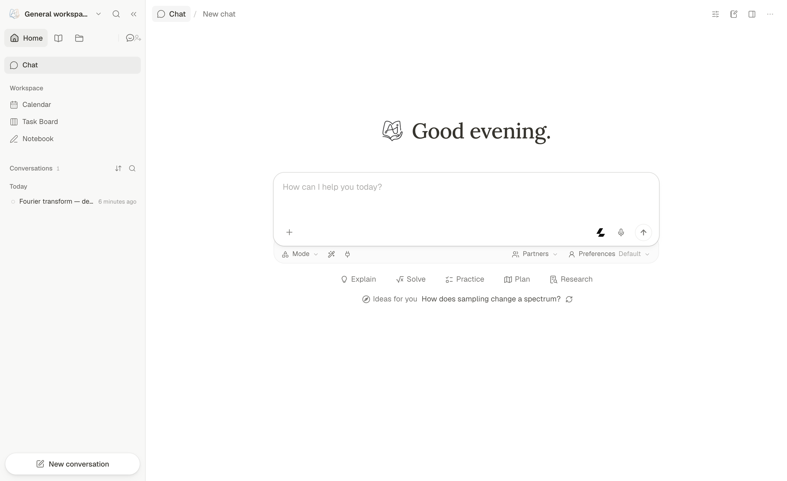
</div>

### 📦 Releases

> **[2026.11.20]** [v1.7.4](https://github.com/HKUDS/DeepTutor/releases/tag/v1.7.4) — Desktop security update for macOS and Windows. Install the new app to trust the replacement runtime signing key.

> **[2026.11.16]** [v1.7.3](https://github.com/HKUDS/DeepTutor/releases/tag/v1.7.3) — Flexible reading and book editing, richer search and agent connections, clearer learning records, and more reliable model streams and desktop upgrades.

<details>
<summary><b>Past releases (more than 1 week ago)</b></summary>

> **[2026.11.6]** [v1.7.2](https://github.com/HKUDS/DeepTutor/releases/tag/v1.7.2) — Complete desktop downloads, selected-text speech, easier model setup, Korean interface preview, NVIDIA NIM embeddings, and more reliable mastery, retrieval, and updates.

> **[2026.11.1]** [v1.7.1](https://github.com/HKUDS/DeepTutor/releases/tag/v1.7.1) — Desktop previews, broader localization, password changes, checked video lessons, Anki and calendar exports, more providers, and wide reliability improvements.

> **[2026.10.28]** [v1.7.0](https://github.com/HKUDS/DeepTutor/releases/tag/v1.7.0) — Modular installation, a refreshed learning workspace, block notebooks with Dito, narrated video lessons, resumable embedding checkpoints, and more reliable tutoring.

> **[2026.10.19]** [v1.6.15](https://github.com/HKUDS/DeepTutor/releases/tag/v1.6.15) — Reviewed learning-path changes, grouped assessments, bounded tutoring memory, reliable chat recovery, sturdier parsing, retrieval comparisons, and native Gemini speech.

> **[2026.10.8]** [v1.6.14](https://github.com/HKUDS/DeepTutor/releases/tag/v1.6.14) — Original-source visual practice, recoverable indexing, unified video Reading, scientific research tools, managed plugins, a learning journal, and provider setup improvements.

> **[2026.10.4]** [v1.6.13](https://github.com/HKUDS/DeepTutor/releases/tag/v1.6.13) — Reading and listening improvements, question-bank practice, resilient document parsing, configurable speech, workspace-visible attachments, Polish, and new providers.

> **[2026.9.27]** [v1.6.12](https://github.com/HKUDS/DeepTutor/releases/tag/v1.6.12) — Workspace KB moves, Kiwix archives, source figures, Task Board, German UI, and chat recovery.

> **[2026.9.24]** [v1.6.11](https://github.com/HKUDS/DeepTutor/releases/tag/v1.6.11) — French and Ukrainian interfaces, reading folders with in-chat selection actions, figures sent to vision models, paged Office previews, and self-syncing knowledge bases.

> **[2026.9.22]** [v1.6.10](https://github.com/HKUDS/DeepTutor/releases/tag/v1.6.10) — Native LightRAG role models, a published index that records and enforces what built it, PDF attachments that follow your parsing engine, visible truncation, and unfiltered provider choices.

> **[2026.9.21]** [v1.6.9](https://github.com/HKUDS/DeepTutor/releases/tag/v1.6.9) — Folder-based learning workspaces, daily practice, redesigned Settings, clearer streaming conversations, persistent usage accounting, and recoverable archives with explicit permanent deletion.

> **[2026.9.14]** [v1.6.8](https://github.com/HKUDS/DeepTutor/releases/tag/v1.6.8) — A recycle bin for deleted chats, search across your whole conversation history, a tool that looks past your knowledge base, and a sweep of fixes for quiet failures.

> **[2026.9.11]** [v1.6.7](https://github.com/HKUDS/DeepTutor/releases/tag/v1.6.7) — A fix release: books that arrived as one empty chapter, quizzes that produced nothing, the model's scratchpad in the text, formulas printed raw, and cards you could not submit.

> **[2026.9.8]** [v1.6.6](https://github.com/HKUDS/DeepTutor/releases/tag/v1.6.6) — A fix release: answers that could not submit, a copy button that lied, connected knowledge bases for partners, Codex sign-in inside Docker, and a 100 KB lighter home route.

> **[2026.9.6]** [v1.6.5](https://github.com/HKUDS/DeepTutor/releases/tag/v1.6.5) — A content workspace you point at any folder, one `exec` tool for every language, Mastery Path modes that gate its tools, and Settings that grades readiness.

> **[2026.9.3]** [v1.6.4](https://github.com/HKUDS/DeepTutor/releases/tag/v1.6.4) — Faster isolated runtimes, controllable Book generation, source-complete Mastery paths and Chat hand-offs, durable Reading, unified activity UI, recoverable sessions, and explicit per-model API capabilities.

> **[2026.9.2]** [v1.6.3](https://github.com/HKUDS/DeepTutor/releases/tag/v1.6.3) — Breaking front/back-end refactor, strict canonical routes and recoverable streams, plus learner/guardian accounts, grounded Reading, WeKnora, broader parsing, Python 3.14, and DashScope media.

> **[2026.8.31]** [v1.6.2](https://github.com/HKUDS/DeepTutor/releases/tag/v1.6.2) — Immersive YouTube learning, a plugin-driven Visualize catalog, three new agent harnesses, safer reading citations, multi-format MinerU, live Partner channel status, and guided updates.

> **[2026.8.30]** [v1.6.1](https://github.com/HKUDS/DeepTutor/releases/tag/v1.6.1) — One vendor key linked to every service it serves, a task model for background work, Settings as a searchable navigator, a sidebar you arrange, and first-party **LightRAG**.

> **[2026.8.27]** [v1.6.0](https://github.com/HKUDS/DeepTutor/releases/tag/v1.6.0) — Faithful EPUB reading and annotations, Courses with Little Tutor and Ask Questions, bounded web-source sync, shared Books with private learning state, and Serply/native search.

> **[2026.8.25]** [v1.5.17](https://github.com/HKUDS/DeepTutor/releases/tag/v1.5.17) — Partners each member owns with private conversations and linkable chat accounts, GitHub repos as a knowledge source, **Antigravity CLI**, browser WeChat QR login, and `deeptutor doctor`.

> **[2026.8.22]** [v1.5.16](https://github.com/HKUDS/DeepTutor/releases/tag/v1.5.16) — **MarginNote 4** libraries you connect and its add-on fills, Book pages that turn again, and tool-call ids, embeddings and temperature limits that stop breaking behind a gateway.

> **[2026.8.20]** [v1.5.15](https://github.com/HKUDS/DeepTutor/releases/tag/v1.5.15) — **PageIndex OSS** you host yourself with reasoning retrieval, a question bank you can finally file into, third-party tool/capability plugins, and **Apache Tika** parsing.

> **[2026.8.19]** [v1.5.14](https://github.com/HKUDS/DeepTutor/releases/tag/v1.5.14) — **Immersive Reading**: a document open beside the thread, cited page by page; DeepTutor configures itself from chat; IMA libraries you browse and write to; a notebook console.

> **[2026.8.17]** [v1.5.13](https://github.com/HKUDS/DeepTutor/releases/tag/v1.5.13) — Books stream while they compile, track your progress, and export to Markdown; a cost estimate before you approve a spine; and home starter suggestions drawn from memory.

> **[2026.8.13]** [v1.5.12](https://github.com/HKUDS/DeepTutor/releases/tag/v1.5.12) — Web search rebuilt with six new providers (**Doubao**, **Bocha**, **Zhipu**, **Firecrawl**, **Qianfan**, **Aliyun IQS**), a **LiteParse** parsing engine, MCP servers that reconnect on credential change, and **CodeBuddy** + **OrcaRouter**.

> **[2026.8.10]** [v1.5.11](https://github.com/HKUDS/DeepTutor/releases/tag/v1.5.11) — Prose around a DSML tool call stops vanishing, a truncated reply continues instead of ending, live memory usage in Settings, and LightRAG indexing off the event loop.

> **[2026.8.7]** [v1.5.10](https://github.com/HKUDS/DeepTutor/releases/tag/v1.5.10) — Every account signs in to its own **Codex**, model output language becomes its own setting, empty tool calls are rejected instead of retried, and uploads stop blocking the loop.

> **[2026.8.4]** [v1.5.9](https://github.com/HKUDS/DeepTutor/releases/tag/v1.5.9) — Gemini **Embedding 2** on its native endpoint, a per-model **reasoning effort** control, a **Novita AI** gateway, retrieval roles for queries, and Compose deployments that keep all of `data/`.

> **[2026.8.2]** [v1.5.8](https://github.com/HKUDS/DeepTutor/releases/tag/v1.5.8) — Memory: a real heap ceiling for the dev server, source installs serve a production build, bounded LLM client and index caches, and a keep-alive fix for stray 500s.

> **[2026.7.31]** [v1.5.7](https://github.com/HKUDS/DeepTutor/releases/tag/v1.5.7) — A per-account **MCP Services** store, 101 **CLI Apps** the tutor can run, credentials moved out of the sandbox's reach, and a mobile layout.

> **[2026.7.29]** [v1.5.6](https://github.com/HKUDS/DeepTutor/releases/tag/v1.5.6) — Remote **Codex** sign-in completes behind an SSH tunnel, generated files get their own card in Activity, non-English languages stop collapsing to Chinese, and book creation no longer times out.

> **[2026.7.26]** [v1.5.5](https://github.com/HKUDS/DeepTutor/releases/tag/v1.5.5) — Sign in with your ChatGPT plan via **OpenAI Codex** OAuth, an **Eden AI** provider, knowledge bases that report what they hold, traceable `rag` citations, and GraphRAG indexing without a workaround.

> **[2026.7.24]** [v1.5.4](https://github.com/HKUDS/DeepTutor/releases/tag/v1.5.4) — Maintenance sweep: the post-answer "generating" stall is gone, IM partners render Markdown tables faithfully, LLM JSON parsing is sturdier, plus quiz, create-KB form, and Math Animator fixes.

> **[2026.7.24]** [v1.5.3](https://github.com/HKUDS/DeepTutor/releases/tag/v1.5.3) — Themeable code blocks, four more coding CLIs in My Agents (Gemini, Kimi, opencode, MiMo), an Atlas Cloud LLM provider, and a broad chat, memory, embedding, and parsing reliability sweep.

> **[2026.7.19]** [v1.5.2](https://github.com/HKUDS/DeepTutor/releases/tag/v1.5.2) — Configurable chat attachment limits, PageIndex retrieval that reasons across your documents via agentic tool calls, broader Anthropic/OpenAI model support, and steadier Book, Knowledge Base, and chat UI.

> **[2026.7.9]** [v1.5.1](https://github.com/HKUDS/DeepTutor/releases/tag/v1.5.1) — Remove a single failed document from a knowledge base — even one stuck in an **error** state — instead of deleting and rebuilding the whole base.

> **[2026.7.4]** [v1.5.0](https://github.com/HKUDS/DeepTutor/releases/tag/v1.5.0) — LlamaIndex ingestion now honors your **Document Parsing** engine with multimodal image extraction, Partner & Soul ids stay URL-safe for non-Latin names, and optional RAG extras install cleanly on Python 3.14+.

> **[2026.6.30]** [v1.4.15](https://github.com/HKUDS/DeepTutor/releases/tag/v1.4.15) — A native **Mattermost** channel for Partners, plus fixes so Guided Learning multiple-choice questions grade correctly and a configured zero chunk overlap is honored.

> **[2026.6.29]** [v1.4.14](https://github.com/HKUDS/DeepTutor/releases/tag/v1.4.14) — Click an assigned partner to chat in one step, Deep Research flags partial reports, LightRAG indexes without MinerU, FAISS handles non-ASCII paths, and PocketBase sessions are isolated per user.

> **[2026.6.27]** [v1.4.13](https://github.com/HKUDS/DeepTutor/releases/tag/v1.4.13) — Partners support non-Latin names and become assignable to users, logos render after login (#599), tiny knowledge bases retrieve reliably, and containers start cleanly under rootless Podman.

> **[2026.6.24]** [v1.4.12](https://github.com/HKUDS/DeepTutor/releases/tag/v1.4.12) — A new **LightRAG Server** retrieval engine, a lightweight **PyMuPDF4LLM** parsing engine, and a FAISS vector backend that makes large knowledge-base retrieval dramatically faster.

> **[2026.6.23]** [v1.4.11](https://github.com/HKUDS/DeepTutor/releases/tag/v1.4.11) — Native tool calling on every cloud OpenAI-compatible provider, a redesigned admin Users page, LaTeX in quiz options, an honest session-loading spinner, and configurable container host binding.

> **[2026.6.21]** [v1.4.10](https://github.com/HKUDS/DeepTutor/releases/tag/v1.4.10) — A self-service **Profile** page with avatars, a rootless-ready container guide with a single-port request-time proxy, and deny-by-default MCP tools for non-admin users.

> **[2026.6.19]** [v1.4.9](https://github.com/HKUDS/DeepTutor/releases/tag/v1.4.9) — Settings polish: Search shows only the fields your provider needs, connection profiles can be renamed and auto-named by provider, and graded Mastery Path questions flow into your Question Bank.

> **[2026.6.18]** [v1.4.8](https://github.com/HKUDS/DeepTutor/releases/tag/v1.4.8) — Connect your own **Partners** under **My Agents** and consult them live in chat — answering through their own persona, library and skills — each with its own private memory.

> **[2026.6.18]** [v1.4.7](https://github.com/HKUDS/DeepTutor/releases/tag/v1.4.7) — Connect your local **Claude Code / Codex** and consult it live mid-turn, **My Agents** graduates to a top-level `/agents`, and Partner conversations gain branch / resume / delete with a replayable trace.

> **[2026.6.17]** [v1.4.6](https://github.com/HKUDS/DeepTutor/releases/tag/v1.4.6) — Four-surface consolidation: a Space learning dashboard with importable **My Agents** and top-level Memory, a **Knowledge Center** with GraphRAG / PageIndex / LightRAG / linked-KB / Obsidian, opened-up Settings, and per-model capability gating.

> **[2026.6.14]** [v1.4.5](https://github.com/HKUDS/DeepTutor/releases/tag/v1.4.5) — Guided Learning rebuilt on the chat agent loop with a hard per-type mastery gate and a `/learning` dashboard, a new loop-plugin framework, plus Markdown export / save-to-notebook for Partner conversations.

> **[2026.6.13]** [v1.4.4](https://github.com/HKUDS/DeepTutor/releases/tag/v1.4.4) — Install community skills from [ClawHub](https://clawhub.ai/) with `deeptutor skill install` behind a security gate, plus real in-browser DOCX/XLSX previews for knowledge-base files.

> **[2026.6.12]** [v1.4.3](https://github.com/HKUDS/DeepTutor/releases/tag/v1.4.3) — TutorBot becomes **Partners** on a production-grade IM pipeline (15 channels, live streaming), Chat moves to a single agent loop, real per-user isolation, and a rebuilt Visualize.

> **[2026.5.28]** [v1.4.2](https://github.com/HKUDS/DeepTutor/releases/tag/v1.4.2) — Stability + polish: Gemini 2.5+ unblocked across Visualize and Chat, auth-routing fix (#485), smooth-streaming chat UX, a Recents sidebar, and Lemonade local-provider support.

> **[2026.5.27]** [v1.4.1](https://github.com/HKUDS/DeepTutor/releases/tag/v1.4.1) — Security + stability: TutorBot tool sandbox locked down, per-user resource isolation, multimodal image fallback, an HTTP/SSE API for TutorBots, and a v1.4.0 chat regression fix.

> **[2026.5.22]** [v1.4.0](https://github.com/HKUDS/DeepTutor/releases/tag/v1.4.0) — GA cut of v1.4: Auto Mode, three-layer Memory, agentic Deep Research / Solve / Question, LlamaIndex RAG refactor, Visualize/Animator merge, and restart-safe turn runtime.

> **[2026.5.21]** [v1.4.0-beta](https://github.com/HKUDS/DeepTutor/releases/tag/v1.4.0-beta) — Three-layer Memory workbench (L1/L2/L3), every chat capability rebuilt on a single agentic engine, LlamaIndex-only RAG, and a unified Settings + Capabilities surface.

> **[2026.5.10]** [v1.3.10](https://github.com/HKUDS/DeepTutor/releases/tag/v1.3.10) — Remote Docker CORS recovery, `DISABLE_SSL_VERIFY` across SDK providers, safer code-block citations, and optional Matrix E2EE add-on.

> **[2026.5.9]** [v1.3.9](https://github.com/HKUDS/DeepTutor/releases/tag/v1.3.9) — TutorBot Zulip and NVIDIA NIM support, safer thinking-model routing, `deeptutor start`, sidebar tooltips, and session-store parity.

> **[2026.5.8]** [v1.3.8](https://github.com/HKUDS/DeepTutor/releases/tag/v1.3.8) — Optional multi-user deployments with isolated user workspaces, admin grants, auth routes, and scoped runtime access.

> **[2026.5.4]** [v1.3.7](https://github.com/HKUDS/DeepTutor/releases/tag/v1.3.7) — Thinking-model/provider fixes, visible Knowledge index history, and safer Co-Writer clear/template editing.

> **[2026.5.3]** [v1.3.6](https://github.com/HKUDS/DeepTutor/releases/tag/v1.3.6) — Catalog-based model selection for chat and TutorBot, safer RAG re-indexing, OpenAI Responses token-limit fixes, and Skills editor validation.

> **[2026.5.2]** [v1.3.5](https://github.com/HKUDS/DeepTutor/releases/tag/v1.3.5) — Smoother local launch settings, safer RAG queries, cleaner local embedding auth, and Settings dark-mode polish.

> **[2026.5.1]** [v1.3.4](https://github.com/HKUDS/DeepTutor/releases/tag/v1.3.4) — Book page chat persistence and rebuild flows, chat-to-book references, stronger language/reasoning handling, RAG document extraction hardening.

> **[2026.4.30]** [v1.3.3](https://github.com/HKUDS/DeepTutor/releases/tag/v1.3.3) — NVIDIA NIM + Gemini embedding support, unified Space context for chat history/skills/memory, session snapshots, RAG re-index resilience.

> **[2026.4.29]** [v1.3.2](https://github.com/HKUDS/DeepTutor/releases/tag/v1.3.2) — Transparent embedding endpoint URLs, RAG re-index resilience for invalid persisted vectors, memory cleanup for thinking-model output, Deep Solve runtime fix.

> **[2026.4.28]** [v1.3.1](https://github.com/HKUDS/DeepTutor/releases/tag/v1.3.1) — Stability: safer RAG routing & embedding validation, Docker persistence, IME-safe input, Windows/GBK robustness.

> **[2026.4.27]** [v1.3.0](https://github.com/HKUDS/DeepTutor/releases/tag/v1.3.0) — Versioned KB indexes with re-index workflow, rebuilt Knowledge workspace, embedding auto-discovery with new adapters, Space hub.

> **[2026.4.25]** [v1.2.5](https://github.com/HKUDS/DeepTutor/releases/tag/v1.2.5) — Persistent chat attachments with file-preview drawer, attachment-aware capability pipelines, TutorBot Markdown export.

> **[2026.4.25]** [v1.2.4](https://github.com/HKUDS/DeepTutor/releases/tag/v1.2.4) — Text/code/SVG attachments, one-command Setup Tour, Markdown chat export, compact KB management UI.

> **[2026.4.24]** [v1.2.3](https://github.com/HKUDS/DeepTutor/releases/tag/v1.2.3) — Document attachments (PDF/DOCX/XLSX/PPTX), reasoning thinking-block display, Soul template editor, Co-Writer save-to-notebook.

> **[2026.4.22]** [v1.2.2](https://github.com/HKUDS/DeepTutor/releases/tag/v1.2.2) — User-authored Skills system, chat input performance overhaul, TutorBot auto-start, Book Library UI, visualization fullscreen.

> **[2026.4.21]** [v1.2.1](https://github.com/HKUDS/DeepTutor/releases/tag/v1.2.1) — Per-stage token limits, Regenerate response across all entry points, RAG & Gemma compatibility fixes.

> **[2026.4.20]** [v1.2.0](https://github.com/HKUDS/DeepTutor/releases/tag/v1.2.0) — Book Engine "living book" compiler, multi-document Co-Writer, interactive HTML visualizations, Question Bank @-mention.

> **[2026.4.18]** [v1.1.2](https://github.com/HKUDS/DeepTutor/releases/tag/v1.1.2) — Schema-driven Channels tab, RAG single-pipeline consolidation, externalized chat prompts.

> **[2026.4.17]** [v1.1.1](https://github.com/HKUDS/DeepTutor/releases/tag/v1.1.1) — Universal "Answer now", Co-Writer scroll sync, unified settings panel, streaming Stop button.

> **[2026.4.15]** [v1.1.0](https://github.com/HKUDS/DeepTutor/releases/tag/v1.1.0) — LaTeX block math overhaul, LLM diagnostic probe, Docker + local LLM guidance.

> **[2026.4.14]** [v1.1.0-beta](https://github.com/HKUDS/DeepTutor/releases/tag/v1.1.0-beta) — Bookmarkable sessions, Snow theme, WebSocket heartbeat & auto-reconnect, embedding registry overhaul.

> **[2026.4.13]** [v1.0.3](https://github.com/HKUDS/DeepTutor/releases/tag/v1.0.3) — Question Notebook with bookmarks & categories, Mermaid in Visualize, embedding mismatch detection, Qwen/vLLM compatibility, LM Studio & llama.cpp support, and Glass theme.

> **[2026.4.11]** [v1.0.2](https://github.com/HKUDS/DeepTutor/releases/tag/v1.0.2) — Search consolidation with SearXNG fallback, provider switch fix, and frontend resource leak fixes.

> **[2026.4.10]** [v1.0.1](https://github.com/HKUDS/DeepTutor/releases/tag/v1.0.1) — Visualize capability (Chart.js/SVG), quiz duplicate prevention, and o4-mini model support.

> **[2026.4.10]** [v1.0.0-beta.4](https://github.com/HKUDS/DeepTutor/releases/tag/v1.0.0-beta.4) — Embedding progress tracking with rate-limit retry, cross-platform dependency fixes, and MIME validation fix.

> **[2026.4.8]** [v1.0.0-beta.3](https://github.com/HKUDS/DeepTutor/releases/tag/v1.0.0-beta.3) — Native OpenAI/Anthropic SDK (drop litellm), Windows Math Animator support, robust JSON parsing, and full Chinese i18n.

> **[2026.4.7]** [v1.0.0-beta.2](https://github.com/HKUDS/DeepTutor/releases/tag/v1.0.0-beta.2) — Hot settings reload, MinerU nested output, WebSocket fix, and Python 3.11+ minimum.

> **[2026.4.4]** [v1.0.0-beta.1](https://github.com/HKUDS/DeepTutor/releases/tag/v1.0.0-beta.1) — Agent-native architecture rewrite (~200k lines): Tools + Capabilities plugin model, CLI & SDK, TutorBot, Co-Writer, Guided Learning, and persistent memory.

> **[2026.1.23]** [v0.6.0](https://github.com/HKUDS/DeepTutor/releases/tag/v0.6.0) — Session persistence, incremental document upload, flexible RAG pipeline import, and full Chinese localization.

> **[2026.1.18]** [v0.5.2](https://github.com/HKUDS/DeepTutor/releases/tag/v0.5.2) — Docling support for RAG-Anything, logging system optimization, and bug fixes.

> **[2026.1.15]** [v0.5.0](https://github.com/HKUDS/DeepTutor/releases/tag/v0.5.0) — Unified service configuration, RAG pipeline selection per knowledge base, question generation overhaul, and sidebar customization.

> **[2026.1.9]** [v0.4.0](https://github.com/HKUDS/DeepTutor/releases/tag/v0.4.0) — Multi-provider LLM & embedding support, new home page, RAG module decoupling, and environment variable refactor.

> **[2026.1.5]** [v0.3.0](https://github.com/HKUDS/DeepTutor/releases/tag/v0.3.0) — Unified PromptManager architecture, GitHub Actions CI/CD, and pre-built Docker images on GHCR.

> **[2026.1.2]** [v0.2.0](https://github.com/HKUDS/DeepTutor/releases/tag/v0.2.0) — Docker deployment, Next.js 16 & React 19 upgrade, WebSocket security hardening, and critical vulnerability fixes.

</details>

> ✨ **v1.7.4 is live.** `pip install -U "deeptutor[full]"` installs the full Web app and CLI; bare `deeptutor` installs core only. See the upgrade steps below for legacy CLI installations.

### 📰 News

- **2026-10-28** 🚀 [**DeepTutor v1.7.0**](https://github.com/HKUDS/DeepTutor/releases/tag/v1.7.0) is here! A fresh look, smoother navigation, and learning tools that work better together.
- **2026-05-22** 🌐 Official docs site live at [**deeptutor.info**](https://deeptutor.info/) — guides, references, and capability tours in one place.
- **2026-04-10** 📄 Our paper is live on arXiv — read the [preprint](https://arxiv.org/abs/2604.26962) for the design and ideas behind DeepTutor.
- **2026-01-01** 🎊 Happy New Year! Join our [Discord](https://discord.gg/eRsjPgMU4t), [WeChat](https://github.com/HKUDS/DeepTutor/issues/78), or [Discussions](https://github.com/HKUDS/DeepTutor/discussions) — let's shape DeepTutor together.
- **2025-12-29** 🎓 DeepTutor is officially released!

## Nimi App integration

This checkout adapts [HKUDS/DeepTutor](https://github.com/HKUDS/DeepTutor) at
`897fce52f24bf22e6e50d8a3e4df532632a26322` (1.6.8, Apache-2.0).
The current scope is formal Nimi integration and representative carrier
acceptance. It does not certify every upstream feature or every model's output.
There is no Release, Registry submission or public publication in this stage.

### Carrier and package baseline

- Next.js and the Python learning workflows remain App-owned. The supervised
  Electron Host owns Python/renderer startup and shutdown, an authenticated
  loopback business API, and SDK/Kit access. Python receives a bounded typed
  model-step protocol, not Nimi credentials, subject selectors or private RPC.
- Both the general LLM factory and the separate agentic client consume Nimi.
  The App executes tools and preserves call/result IDs, ordering, opaque
  continuity and successful terminal state. Failed or cancelled steps are not
  silently replayed or converted into completed answers.
- App Tools **0.7.4**, SDK **0.14.0**, Kit **0.10.1**, Kit-owned darwin-arm64
  native **0.10.0**, nimi-coding **0.6.3**, pnpm **10.34.5**. Complete delivered
  tarballs are selected through workspace overrides and the installed lockfile;
  formal dependency version declarations remain in `package.json`.
- Packaged Electron **42.11.4**; Desktop development Host **42.10.1**. The Python
  `.venv` uses the original dependencies plus `dev,nimi-host`. The macOS arm64
  payload contains real Next standalone assets and a frozen Python backend.
- Current Runtime: clean Nimi commit `35ce54412`, binary SHA256
  `4273731bf3f7cd45b0599e186910995d3825a57e6282792d127dc98256bacdd4`.
  Earlier Cloud acceptance used the same functional D2 build with SHA256
  `109108ba9a004e41edae8ff4868b41b832c8e0b11c111cb9c9cc11199535192c`.
  It includes the complete-assistant-history Driver fix and the formal
  non-thinking DeepSeek tool adapter. Runtime-only rebuilding did not replace
  the npm package combination.
- Text selection is currently Cloud `deepseek-flash`. Earlier representative
  Local acceptance used Gemma 4 26B-A4B Q8_0. Embedding stayed on the same machine
  selection: Nomic 768-dimensional GGUF embeddings, with Runtime-issued
  `spaceId` persisted and checked against each index operation.

### Representative evidence

| Boundary / flow | Actual result |
| --- | --- |
| Same-package reference | Distinct reference App passed supervised text and embedding calls; no claim that the reference is DeepTutor. |
| Real document and tools | The 15-page [Attention Is All You Need PDF](https://arxiv.org/abs/1706.03762) passed original parsing/indexing/retrieval, model/tool steps, cited response and notebook save/reopen. Local and Cloud evidence are recorded separately. |
| Cloud Research | The initial report had errors. A native follow-up revision correctly checked Table 3 and page references; only that final turn was saved/reopened as notebook record `7b0b870c`. This is a revision-chain result, not one-shot success. |
| Cloud Quiz / Solve | One four-option question passed wrong answer → retry → correct → reload and question-bank persistence (entry `10`). The quadratic task passed two methods and both substitutions, then notebook save/reopen (`7c871513`). |
| Both text consumers | Cloud Co-Writer edited only the selected paragraph, reopened and exported the actual 152-byte Markdown file (`5faf9b388dc3`). Earlier Gemma evidence separately covered the general factory, Quiz and Solve. |
| Scope and lifecycle | Reload during generation, explicit cancellation, subsequent new turn and same-registration reopen passed. Typed regressions cover scope invalidation and late-result rejection. Sync embedding cannot stop active native inference; late results are discarded before index commit. |
| Same-Host Runtime recovery | After idle Runtime restart, the first new request failed with `runtime-service-unavailable`. Formal `auth.status` → `aiConfig.get` recovered on the same Host. The global **Reconnect Nimi** action now performs these reads without changing models or replaying work. Unsent input remained unchanged; an explicit subsequent send created a new successful turn (`turn_1789551600563_c13bfe6abf`). |
| Preview boundary | A same-origin page opened through the real web preview could not read its parent (`SecurityError`). Preview scripts do not inherit the parent's Nimi bridge. |
| Builds and checks | App Tools sync/check, TypeScript, targeted boundary tests and actual Next/PyInstaller/Electron builds passed. The frozen backend passed authenticated HTTP and Chinese notebook persistence. |
| Installed carrier | Manager verified the final local package through Desktop import and two formal launches on macOS arm64 D2. Notebook `d1e21bd6` and session `unified_1789554736520_5ae6864e` reopened after Stop → Launch; Nimi Access and the public `deepseek-flash` configuration read were ready. |

The first planned in-flight restart target completed **31.6 seconds before**
Runtime stopped; that attempt proves only idle-restart behavior. Live Runtime
interruption and account-switch journeys remain **NOT-VERIFIED**. They are not
inferred from the cancellation tests or a successful reconnect. No full Gemma
or optional-backend regression is required for this integration delivery.

The App's conversation budget defaults to **32,768 estimated tokens**, including
actual output reserve and `max(1024, ceil(input * 10%))` safety margin. This is an
App policy, not the model's physical window. Guard, trace and composer use the
same request projection. Opaque continuity contributes only known transport
bytes; internal tokens remain unknown. Explicit
`capabilities.chat.working_context_budget` in `data/user/settings/agents.yaml`
takes precedence. Unread tool evidence is not silently erased to fit.

### Storage and local installation

Learning sessions, files, indexes, notebooks and learning memory remain
DeepTutor-owned business data. Development uses the selected Host's
`userData/workspace`; continue it with official `nimi-app dev --list-registrations`
and an explicit `--resume` selection. It is registration-specific storage, not
a Nimi-account authorization partition. Do not discover or merge sibling
workspaces. Native exec isolation is APPLICATION-level, not an OS sandbox.

The local package uses the upstream logo with four transparent pixels added
above and below to meet the square-icon requirement; it is not new branding.
Publisher-side ad-hoc sealing supplies no Developer ID or notarization. Formal
`pack --production` must observe the actual native trust and execution facts.
The production Host explicitly uses
`~/Library/Application Support/org.nimiplatform.deeptutor` as its profile,
with business data in `workspace/`. Development keeps Desktop's separate
registration directory. No development data is copied or migrated. No Catalog
or release workflow is involved.

**Local installation acceptance: PASS, 2026-09-16.** The final archive is
`dist/nimi-app/org.nimiplatform.deeptutor-1.6.8-macos-aarch64.nimiapp`
(1,524,852,303 bytes), SHA256
`748d4734c2e5a5a3cb7b0e2a5410a2d5e797abc98b6b91f3108b7443af5de32f`.
Its observed posture is `production-unsigned`, current-user execution, no
Developer ID and no notarization. This verifies the current macOS D2
source-local-development carrier only, not a fixed-service topology or public
distribution. Desktop Stop released the owned Host/Python processes and ports;
the next formal launch reopened the same Chinese notebook and source chat.
The actual installed AI response and generated notebook summary were verified
on the preceding candidate, whose AI consumer code is unchanged by the final
cache fix; the final candidate reused that saved result and read configuration
without repeating inference.

Failure history is retained: candidate `10a28ac0…` installed but its Next child
failed to resolve `@swc/helpers` after symlink flattening. Candidate `026f0031…`
fixed startup and passed real AI/save, but two image-cache files changed the
sealed payload and the next launch correctly failed provenance validation.
Both old archives and sidecars remain under `.nimi/local/install-candidates/`.
The final candidate preserves the dependency layout and avoids those writes;
Runtime integrity enforcement was not weakened.

The Nimi production build disables Next image/ISR disk-cache writes into its
immutable resources while retaining image optimization and memory caching.
The final component check fetched the page and both optimized logo images:
HTTP 200, 8,250 tree entries unchanged, and strict code-signature verification
passed before and after. Next's pnpm links and Python framework links are
preserved inside the payload. Startup failures are recorded, with bounded
child stderr, in `workspace/logs/startup-error.log` under the App-owned profile.

### Local source audit (2026-09-16)

The pre-commit integration audit fixed two lifecycle defects: Host cleanup now
recognizes children that already exited by signal, and explicit new/regenerated
turns on a surviving WebSocket capture the current Nimi generation. Existing
tasks retain their old scope; reconnect does not replay them.

Current-source checks passed: six Node tests (including real OS child shutdown
and authenticated Python persistence), 40 Python Nimi boundary tests, Host
TypeScript and Electron compilation, frontend TypeScript, App Tools check and
sync dry-run, 18 WebSocket protocol/runtime regressions and three frontend
connection tests. Earlier
representative business and installed-carrier results above remain historical
evidence. The archive with SHA256 `748d4734…` predates these two audit fixes;
their rebuilt installed-App journeys are **NOT-VERIFIED**. This source commit
does not replace the installed package or publish a release.

Local tarballs under `.nimi/local/packages/` are required by the workspace
overrides and lockfile. They are intentionally excluded from Git, as are App
data, the Python environment and build archives. A fresh clone needs the same
manager-delivered package combination before installation; public CI/release
portability is not claimed. Build-generated `web/next-env.d.ts` and the copied
PDF.js QCMS license change are excluded from the adaptation commit.

### Additional upstream changes retained for separate review

The integration session also accumulated the changes below. They are retained
without automatic rollback, but are **not additional integration completion
conditions** and do not imply a general DeepTutor quality release:

- RAG caption-adjacent context and Book full-source/layout transfer; section and
  callout evidence handling. PDF layout expansion is bounded to two retrieved
  table pages and 16,000 characters per page, with explicit omissions. The
  original regenerated Book chapter still had factual contradictions; its
  `ready` state is not content acceptance. No more generation is being pursued.
- Research outline persistence, activity/recovery presentation and failure
  propagation; Mastery current-question feedback, unposed-question checks and
  saved-mode hydration.
- Reading-to-notebook endpoint correction, Book estimate endpoint and reopened
  draft settings. Their observed outcomes are distinct from the Nimi carrier.
- Additional course, reading and learning-memory exercise data. L2 facts and
  manual edits persisted; an over-inferred L3 batch was undone. Notebook-memory
  cancellation retained completed edits and discarded unfinished output.

Book facts/model hallucinations, teaching strategy, optional Manim/LaTeX,
OCR/model parsing, image embeddings, reranking, generative media and external
AI harnesses are outside this representative acceptance. Unrun paths remain
**NOT-VERIFIED**; none is silently removed or replaced by private inference.

## ✨ Key Features

DeepTutor is an agent-native learning workspace that connects tutoring, research, creation, and practice in one extensible system.

- **One runtime, many learning modes** — Chat, Quiz, Research, Visualize, Solve, Mastery Path, Reading, and more share session context while retaining purpose-built workflows.
- **A connected learning workspace** — Home, Learning, and Resources connect Chat, Books, Reading, Practice, Task Board, Calendar, and Learning notebook with shared materials, progress, and learning context.
- **Grounded knowledge and reading** — Build versioned libraries with LlamaIndex, PageIndex, GraphRAG, or LightRAG, connect external knowledge sources, and learn beside documents, video, and audio with source-linked citations.
- **Partners and subagents** — Consult live agents such as Claude Code, Codex, and Grok CLI, import past conversations, or run persistent Partners with their own memory, resources, and IM channels.
- **Inspectable memory** — L1 traces, L2 facts, and L3 synthesis make personalization visible and editable, with evidence links you can audit in the Memory Graph.
- **Extensible by design** — Add personas, built-in or community skills, MCP services, CLI apps, and generation models through one agent-native runtime.

---

## 🚀 Get Started

Choose the installation path that fits how you want to use DeepTutor. Terminal-based installs share one runtime home: private settings live in `data/user/settings/` under the launch directory, or under `DEEPTUTOR_HOME` / `deeptutor start --home` when set explicitly. After starting the app, configure a provider and model in **Settings → Providers** and **Language models**.

<details>
<summary><b>Desktop — macOS and Windows (Preview)</b></summary>

**Open DeepTutor** bundles Python, Node.js, and the full learning workspace, so no terminal or separate runtime installation is needed. Download published desktop builds from the [latest GitHub Release](https://github.com/HKUDS/DeepTutor/releases/latest), choosing the installer for your computer below.

For development previews, open a successful [Desktop Release workflow run](https://github.com/HKUDS/DeepTutor/actions/workflows/desktop-release.yml?query=branch%3Adev) and download the matching **Artifact**. These previews require GitHub sign-in and expire after seven days; published release downloads do not.

| Your computer | Download target | Installer |
| --- | --- | --- |
| **Mac with Apple Silicon** | `macos-arm64` | Open the DMG and drag **Open DeepTutor** into **Applications**. |
| **Mac with Intel** | `macos-x64` | Open the DMG and drag **Open DeepTutor** into **Applications**. |
| **Windows x64** | `windows-x64` | Run the Setup `.exe`, or extract the portable ZIP and launch `Open DeepTutor.exe`. |

Windows preview builds are unsigned and may show a SmartScreen warning. See the [desktop guide](apps/desktop/README.md) for signing, local data, and source builds.

</details>

<details>
<summary><b>Docker — Fastest Full-App Trial</b></summary>

Run the full Web app without installing Python or Node.js:

```bash
docker run --rm --name deeptutor \
  -p 127.0.0.1:3782:3782 \
  -v deeptutor-data:/app/data \
  ghcr.io/hkuds/deeptutor:latest
```

Open [http://127.0.0.1:3782](http://127.0.0.1:3782). The named volume preserves settings and local data; only port `3782` is required for the Web app. See the [Docker guide](https://docs.deeptutor.info/get-started/docker/) for host workspaces, local model services, reverse proxies, and production deployment.

</details>

<details>
<summary><b>PyPI — Full Web App and CLI</b></summary>

Use **Python 3.11–3.14** and **Node.js 20.9+**. In the modular 1.7.0 release, `deeptutor[full]` installs the Web app and CLI; bare `deeptutor` installs core chat and the SDK.

```bash
mkdir -p my-deeptutor && cd my-deeptutor
python -m pip install -U "deeptutor[full]"
deeptutor init     # ports + LLM provider + optional embedding/search
deeptutor start    # starts backend + frontend
```

Open the URL printed in the terminal, by default [http://127.0.0.1:3782](http://127.0.0.1:3782). Press `Ctrl+C` to stop both services.

**Upgrading from 1.6.15 or earlier:** stop DeepTutor, back up the runtime home, and uninstall a legacy `deeptutor-cli` package before installing the new family. Keep the same `DEEPTUTOR_HOME`, then run `python -m pip check` and `deeptutor module list`. See the [PyPI and migration guide](https://docs.deeptutor.info/get-started/pypi/) for the exact upgrade commands.

</details>

<details>
<summary><b>Source — Current Dev and Contributors</b></summary>

Use **Python 3.11–3.14** and **Node.js 22 LTS** to match CI and Docker.

```bash
git clone --branch dev https://github.com/HKUDS/DeepTutor.git
cd DeepTutor
python3 -m venv .venv && source .venv/bin/activate
python -m pip install --upgrade pip
python -m pip install -r requirements/full.txt
python -m pip install -e . --no-deps
( cd web && npm ci --legacy-peer-deps )
deeptutor init
deeptutor start --dev
```

Use `deeptutor start` without `--dev` for a production build. Optional dependencies are installed from the repository root, for example `python scripts/install_extras.py dev,partners,math-animator`. See the [source installation guide](https://docs.deeptutor.info/get-started/from-source/) for Conda, extras, and troubleshooting, or the [Agent Setup guide](docs-for-dev/AGENT_SETUP.md) to let a terminal-capable agent perform and verify the setup.

</details>

<details>
<summary><b>CLI — Terminal and Agent Use</b></summary>

For a minimal terminal installation, use the core wheel; no Node.js or Web frontend is required:

```bash
mkdir -p my-deeptutor && cd my-deeptutor
python -m pip install -U deeptutor
deeptutor init --cli
deeptutor chat
```

Core includes Chat, Ask Questions, the CLI, and the SDK; other capabilities and management commands require their matching feature modules. For the current `dev` source installation and optional dependencies, see the [CLI-only guide](https://docs.deeptutor.info/get-started/cli-only/). The [CLI reference](#%EF%B8%8F-deeptutor-cli--agent-native-interface) below covers one-shot runs and machine-readable output.

</details>

**Workspaces and advanced setup:** see [Content Workspaces](docs-for-dev/workspaces.md), [Local Data Persistence](docs-for-dev/DATA_STORAGE.md), [Containerization and Sandbox Deployment](docs-for-dev/CONTAINERIZATION.md), [Configuration Reference](https://docs.deeptutor.info/get-started/pypi/#config-files-under-datausersettings), and [Troubleshooting](https://docs.deeptutor.info/get-started/troubleshooting/).

## 📖 Explore DeepTutor

Start with a **workspace** for each subject or project. Home, Learning, and Resources change with the active workspace; Partners and Personalization remain available across workspaces.

| Area | Scope | What it contains |
| --- | --- | --- |
| **Home** | Workspace | Chat, Task Board, Calendar, and Learning notebook |
| **Learning** | Workspace | Books, Mastery Path, Immersive Reading, and Practice |
| **Resources** | Workspace | Chat History, Favorites, Learning journal, Question Bank, and Knowledge Center |
| **Partners** | Account | Persistent companions, Partner Groups, resource access, and IM channels |
| **Personalization** | Account | My Agents, Personas, Skills, MCP Services, CLI Apps, Memory, and Settings |

<details>
<summary><b>🏗️ System architecture</b></summary>

<div align="center">
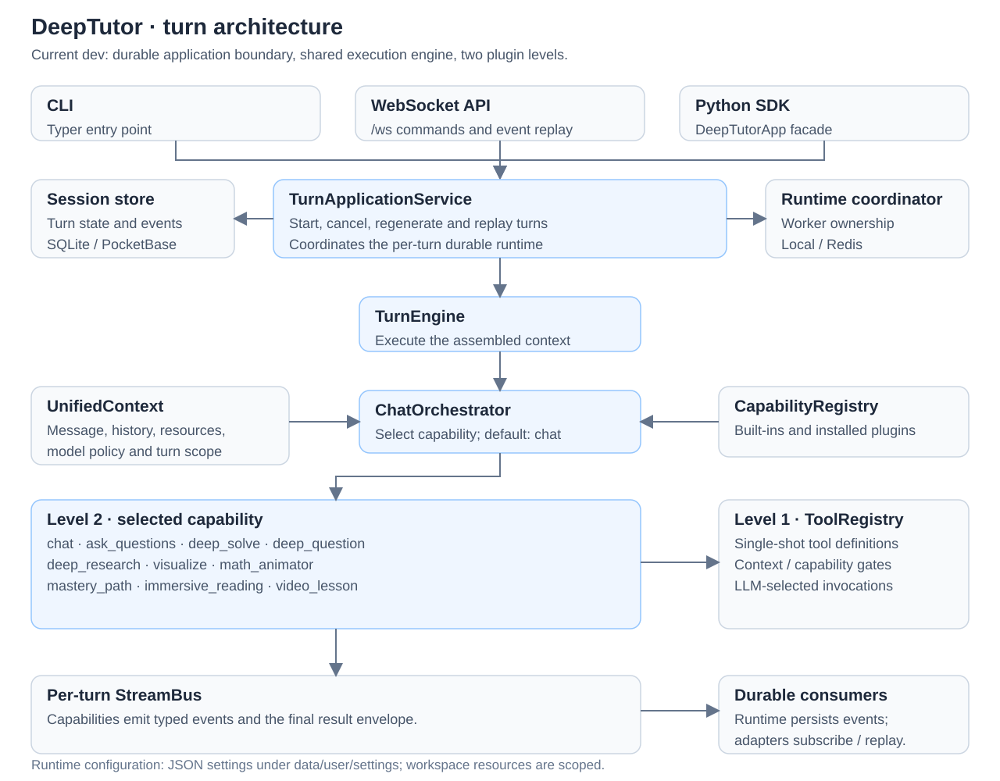
</div>

</details>

<details>
<summary><b>🏠 Home — Conversations, Tasks, Notes, and Calendar</b></summary>

Home is where daily work begins: talk to the tutor, organize next actions, and develop your own notes in the current workspace. Calendar provides an account-wide view while retaining the source workspace for study events.

<details>
<summary><b>💬 Chat — The Agent Loop You Actually Use</b></summary>

Chat is the default capability and where most work begins. A single thread can talk normally, call tools, ground itself in selected knowledge bases, read attachments, generate images, consult subagents, write notebook records, and continue with the same context across turns.

<div align="center">
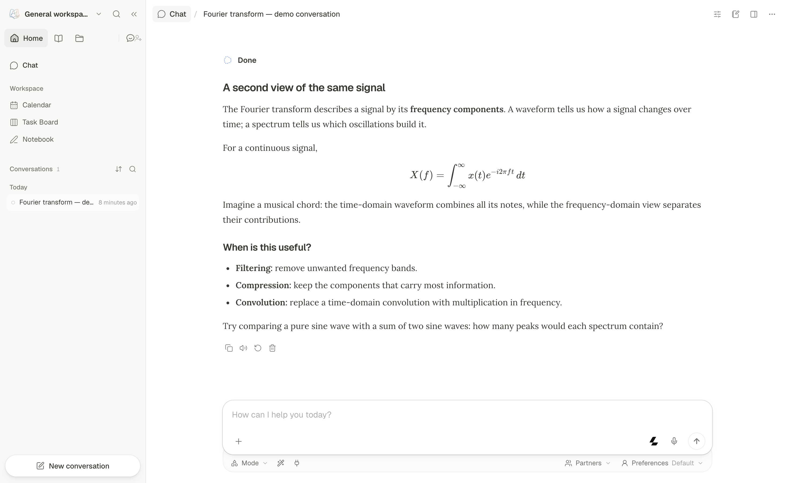
</div>

The tutor calls tools as needed and can pause to ask clarifying questions. **Customize page**, at the upper right, chooses the visible modes and Skills, MCP, Partners, Preferences, and voice-input controls. Under **Starting prompts**, add, edit, or remove the titles and prompts in Explain, Solve, Practice, Plan, and Research. Save applies your account preferences; Cancel discards edits, and Restore defaults brings back the original choices.

<div align="center">
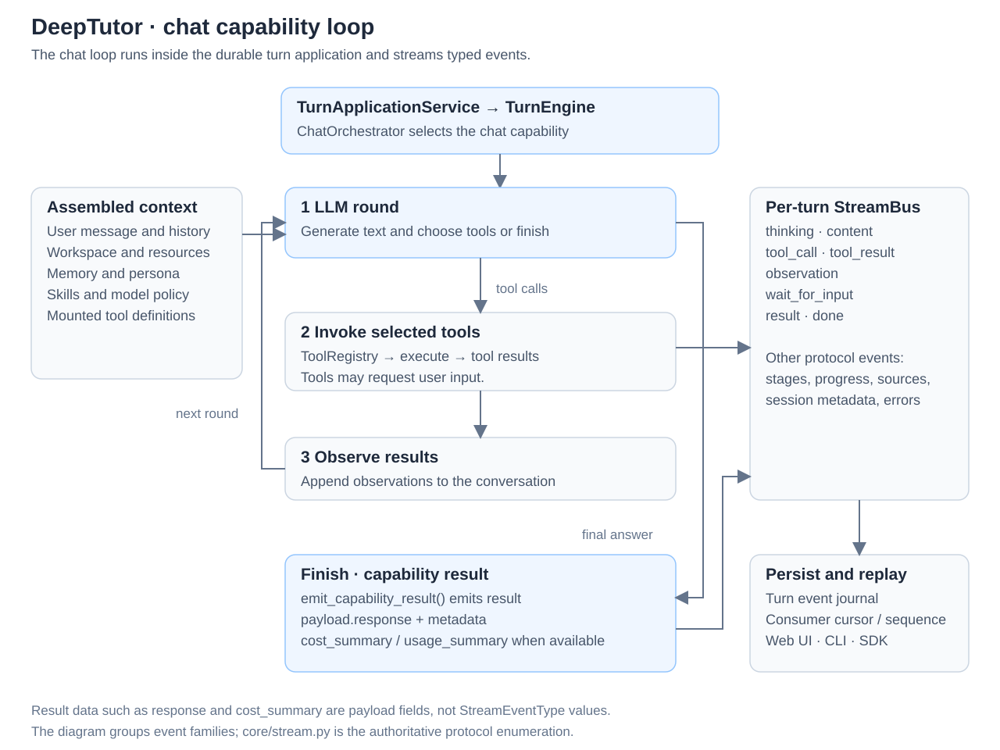
</div>

User-toggleable tools are `brainstorm`, `web_search`, `paper_search`, `zotero_search`, `reason`, and `geogebra_analysis` — plus `imagegen` and `videogen` once you configure the matching generation model. Contextual tools such as `rag`, `kb_files`, `knowledge_frontier`, `read_source`, `read_memory`, `write_memory`, `read_skill`, `load_tools`, `exec`, `web_fetch`, `ask_user`, `list_favorites`, `save_favorite`, `write_note`, `search_notes`, `question_bank`, `github`, `consult_subagent`, `workspace_list`, `workspace_read`, `workspace_search`, `workspace_present`, and `workspace_export` mount automatically when the turn has the right context.

Context comes in two kinds: **sticky session context** (capability, workspace or course, tools, knowledge bases, persona, model and supported reasoning effort, and Reading / Mastery state) persists across turns; **references** (files, chat history, books, reading sections, notebooks, selected question-bank entries, imported agents) come from the `+` menu for one turn by default, or every turn when pinned. The voice button only transcribes the current message.

**Reasoning-only output limits.** The shared agent loop retries once when internal reasoning uses the output budget without an answer or tool action. The default `prompt` strategy keeps the same budget. To stop immediately, set `strategy: stop` under `capabilities.chat.reasoning_budget_recovery` in your runtime `settings/agents.yaml`. An explicit larger budget can help models that need more room, at the cost of potentially higher latency and usage:

```yaml
capabilities:
  chat:
    responding:
      max_tokens: 8000
    reasoning_budget_recovery:
      strategy: increase_output_budget
      max_tokens: 16000
```

The recovery limit must exceed the normal output limit and be at most 131072; choose a value supported by your model. It applies to one recovery call only, retains the existing round and request-timeout bounds, and leaves reasoning effort unchanged. The trace records the policy, old/new limits, effective per-call budgets, and accumulated usage. Visible answer truncation keeps its normal continuation. With the experimental `typescript-native` runtime, explicit `stop` or `increase_output_budget` policies select the shared Python effects host with the TypeScript scheduler before the turn begins; the result reports that compatibility reason.

The Python history builder also enforces its history plan after condensation. If a complete retained exchange still exceeds that budget, the turn stops with `history_budget_exceeded` before answer generation. Stored messages and tool-call/result pairs remain intact; start a new conversation or shorten the oversized earlier exchange to continue. This history allowance is separate from the model's full context-window capacity.

With the full profile, Home keeps **Chat**, **Ask Questions**, **Quiz**, **Visualize**, and **Video Lesson** one click away; **Research** for cited reports and **Solve** for worked reasoning sit under *More Capabilities*. Select text in an answer to open **Little Tutor**, a focused sidebar thread that stays nested under the source conversation. With at least three sent messages, the left gutter shows a tick for each question when space allows; hover to preview, click to jump back, or use **Alt/Option + ↑/↓** to move between questions.

</details>

<details>
<summary><b>✅ Task Board & Calendar — Organize Daily Learning</b></summary>

**Task Board** tracks study tasks in To do, In progress, and Done, with notes, drag-and-drop or keyboard-accessible move controls, and a restorable archive. Tasks stay in the current workspace and require no model configuration.

**Calendar** keeps personal study sessions, repeating events, and reminders together, with `.ics` export for Apple Calendar, Google Calendar, Outlook, and Thunderbird. Workspace overlays such as task due dates and reviews remain connected to their source workspace.

</details>

<details>
<summary><b>✍️ Learning Notebook — Pages, Sources, and Dito</b></summary>

<div align="center">
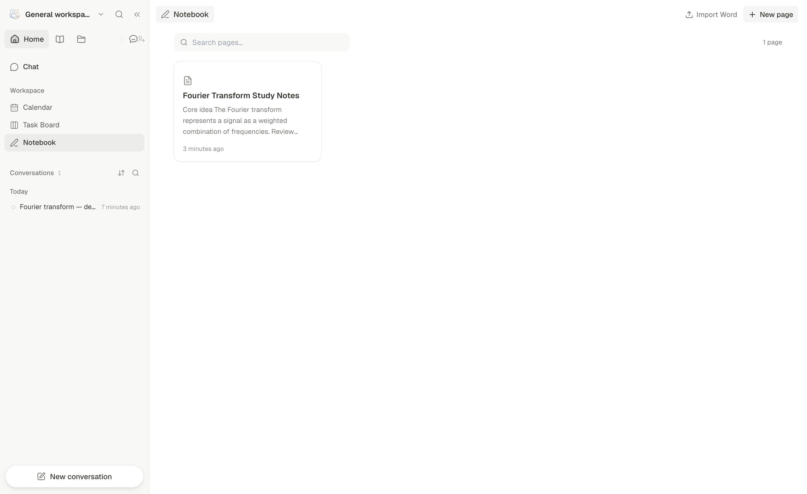
</div>

The Learning notebook, formerly Co-Writer, organizes your own writing into pages, subpages, and blocks within the active workspace. Import Word documents, arrange a page tree, and insert original records from Favorites as evidence. Pages keep their save status visible and export as Markdown or Word; interactive content becomes static in Word.

**Export flashcards to Anki.** Notebook pages can include Flash Cards. On a page that has them, open the page menu and choose **Export flashcards (Anki)**. From the notebook review queue, choose **Export all for Anki**. In Anki, use **File → Import** and select the downloaded `.txt` file. Cards land in a deck named `DeepTutor::<note title>` with front/back fields, tags, and math preserved. Re-importing the same file updates existing cards instead of duplicating them. DeepTutor's own review schedule is not included.

<div align="center">
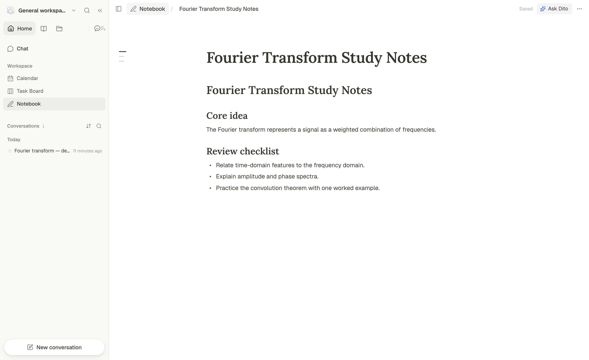
</div>

Discuss a passage or block with **Dito**: ask for an explanation, example, rewrite, or practice question. Conversations remain attached to the relevant page and line. Review proposed changes before accepting them, or insert an answer below the line and keep working. Favorites preserve source records; the notebook is where you build your own understanding.

</details>

</details>

<details>
<summary><b>🎓 Learning — Books, Paths, Reading, and Practice</b></summary>

Learning is the current workspace's study area. Create an activity from **Learning → New learning**, then reopen it from **All learning** with its progress, conversations, and source context intact.

<div align="center">
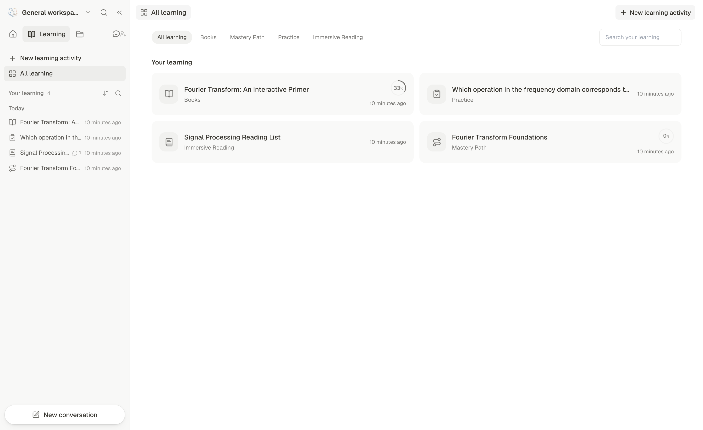
</div>

| Activity | Use it for | What you keep |
| --- | --- | --- |
| **Book** | Build a structured, interactive book from selected sources | Editable chapters, typed blocks, reading progress, and Page Chat |
| **Mastery Path** | Break a learning goal into topics and guided study | A knowledge-point map, topic conversations, and mastery evidence |
| **Immersive Reading** | Work beside a document, web page, video, or audio source | Source-linked conversations, verified citations, highlights, notes, and progress |
| **Practice** | Review collected or imported questions | Answers, mistakes, recall ratings, and the next review date |

<details>
<summary><b>📖 Book — Living Books from Your Materials</b></summary>

<div align="center">
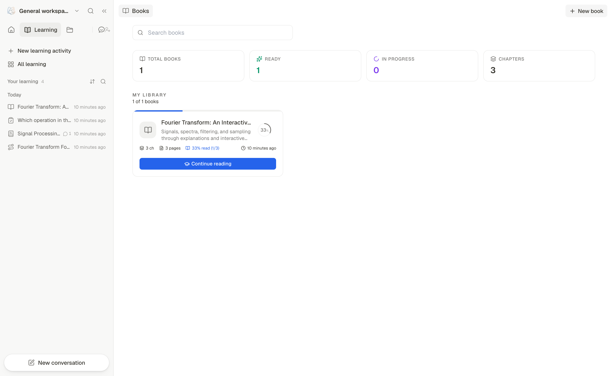
</div>

Book turns selected sources into an interactive **living book** — not a static PDF, but a reading environment built from typed blocks. A book can start from knowledge bases, Favorites, question banks, or chat history; the creation flow proposes a chapter outline before content is generated, so you review the shape instead of accepting a blind one-shot output.

<p align="center">

&nbsp;
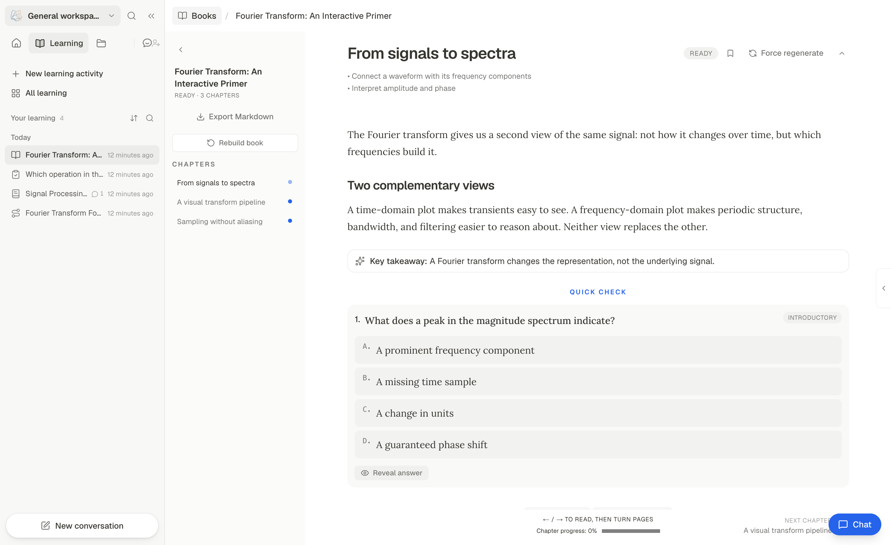
&nbsp;
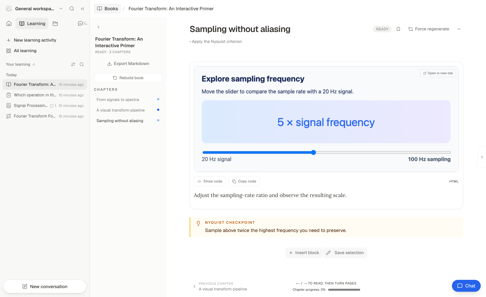
</p>

Each chapter compiles into editable typed blocks — text, callouts, quizzes, flash cards, timelines, code, figures, interactive HTML, animations, concept graphs, deep dives, and user notes — with its own Page Chat. Review and undo chapter or section edits; insert, move, regenerate, rewrite, or switch blocks; selected passages enter a learning-capture inbox. Progress, bookmarks, quiz attempts, captures, and Page Chat stay private per reader even when an admin book is shared read-only or for collaborative editing; shared deletion stays admin-only. Any book exports to Markdown, long compiles pause and resume, `deeptutor book health` flags source drift, and `deeptutor book refresh-fingerprints` refreshes the source baseline.

</details>

</details>

<details>
<summary><b>🗂️ Resources — Materials and Saved Learning Records</b></summary>

Resources is the current workspace's reusable library. Keep original material, saved results, and learning records here so they can be attached to new conversations and activities without mixing projects.

<details>
<summary><b>📚 Knowledge Center — Multi-Engine RAG Libraries</b></summary>

<div align="center">
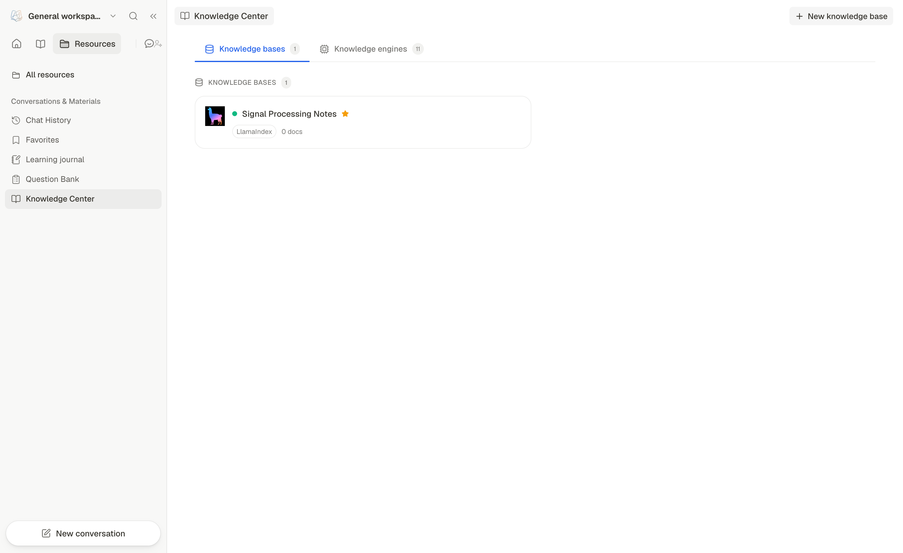
</div>

Knowledge bases are the document collections behind RAG — they ground Chat turns, Learning notebook edits, Book generation, and Partner conversations. What's distinctive is a **choice of retrieval engines**: **LlamaIndex** (the default, hybrid vector + BM25 with optional cross-encoder reranking and exact-flat or HNSW FAISS indexes), **PageIndex** (reasoning retrieval with page-level citations, hosted or self-hosted OSS), **GraphRAG** and **LightRAG** (knowledge-graph retrieval), **LightRAG Server** (retrieval offloaded to an external LightRAG instance you connect over HTTP), **WeKnora** (retrieval from a knowledge base in your self-hosted deployment, without a local index or document copy), **Tencent IMA** (a library you curate in IMA — searched, browsed, and written back to over its OpenAPI), **MarginNote 4** (your MN4 study data — documents, excerpts, mind-map cards and the links between them — pushed in by the app's Add-on and navigated with dedicated tools), **Kiwix** (a searchable ZIM archive served over HTTP without local indexing), or a linked **Obsidian** vault the tutor reads and writes in place. Each KB is bound to one engine.

<div align="center">
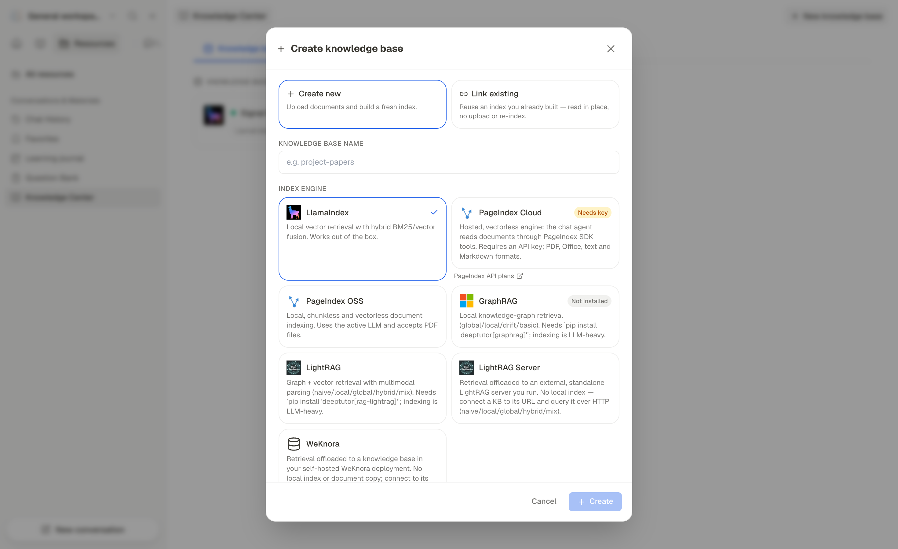
</div>

Migrating an existing Obsidian, Hermes, or Markdown library? See [Knowledge migration guide](./docs-for-dev/KNOWLEDGE_MIGRATION.md) for connected-vault and indexed-copy paths.

Creating a KB, you can **create new** (upload and index documents), **link existing** (reuse an index in place), or **connect Kiwix** (search one served ZIM archive on demand). Choose its storage workspace at creation; an existing KB can move between workspaces after a preview, keeping assignments and saved references. A KB can also track **GitHub repositories** (repo, branch, glob) or **documentation-site URLs** (bounded crawl depth and page count, re-synced every 24 h by default); sync hash-diffs added, changed, and removed content so followed documentation stays current without re-uploading, and **linked folders** pick up new or changed local files on sync. Re-indexing writes a new flat `version-N` directory and keeps prior ones, so a working index is never destroyed mid-rebuild. A single document can be removed even from an **error**-state base — dropping a file that failed to parse without a full delete-and-rebuild. Document parsing — Text-only, MinerU, Docling, Tika, markitdown, PyMuPDF4LLM, or LiteParse — and an optional image-description model are chosen in **Settings → Knowledge & documents**, with local model downloads off by default. Docling can also run in **remote** mode against a Docling Serve server (no local install or models needed), configured on that page (`mode=remote`, a server base URL, and an optional API key) or the `DOCLING_MODE` / `DOCLING_API_BASE_URL` / `DOCLING_API_TOKEN` environment variables. Tika is remote-only and points at the Apache Tika server configured on that page. The CLI mirrors the lifecycle with `list/info/create/connect-kiwix/add/search/eval/eval-diff/set-default/delete`, source add/remove commands, `list-sources`, and `sync`.

The built-in LightRAG engine is installed with `pip install 'deeptutor[rag-lightrag]'`. That extra contains the supported LightRAG SDK but does not install MinerU. Choose MinerU independently in Document Parsing and either configure its cloud mode or install its current local CLI when structured parsing is wanted. MinerU accepts PDF, common raster images, DOCX, PPTX, and XLSX; the legacy `magic-pdf` command remains PDF-only. Text-only and the other parsing engines do not require MinerU.

Native LightRAG queries and incremental indexing require the embedding configuration recorded by the published index, including the model, dimension, and endpoint identity. If it changes, restore the original configuration or rebuild with the current embedding; indexes without a recorded embedding identity require a rebuild. The knowledge-base detail and index-version views show recovery guidance, while files remain available for viewing and download.

OpenAI-compatible HTTP embedding responses with explicit vector indices are restored to input order. Repeated, missing, or invalid indices are rejected before the vectors reach indexing; index-free proxy responses retain positional ordering. If a gateway previously returned reordered indexed vectors, rebuild affected indexes to replace their old text/vector associations. Existing index files are preserved.

**Scoring a knowledge base.** With several engines available, "which one retrieves best here?" is an empirical question — so `deeptutor kb eval` answers it. Write a QA set (one JSON object per line: a `query` plus the `gold` passages an ideal retrieval should return), then score the KB with `deeptutor kb eval <name> --dataset qa.jsonl --top-k 5 [--mode hybrid] [--save baseline.json]`. Each case is retrieved through the same path a chat turn uses, its ranked citations are matched against the gold passages using exact text or lexical overlap (thresholds are tunable with `--min-ratio`; semantic equivalence is not assessed), and the run reports **Recall@k / Precision@k / nDCG@k / MRR / MAP / Hit@k**. Metrics are pure functions over the ranking; no model judges the output. Compare saved reports with `deeptutor kb eval-diff baseline.json candidate.json` for per-metric and per-case changes. Use `--rewrite off` or `--rewrite standalone` on `kb eval` to compare original and rewritten queries; reports retain rewrite provenance. Cases whose search failed (a missing index, bad credentials) carry no score and are reported separately rather than dragging the means down. PageIndex uses reasoning as retrieval and returns no ranked chunks, so it is excluded.

```jsonl
{"query": "Why do transformers scale attention?", "gold": ["Scaling keeps the dot products from growing with the dimension."]}
```

</details>

<details>
<summary><b>🗃️ History, Favorites, Journal, and Question Bank</b></summary>

<div align="center">
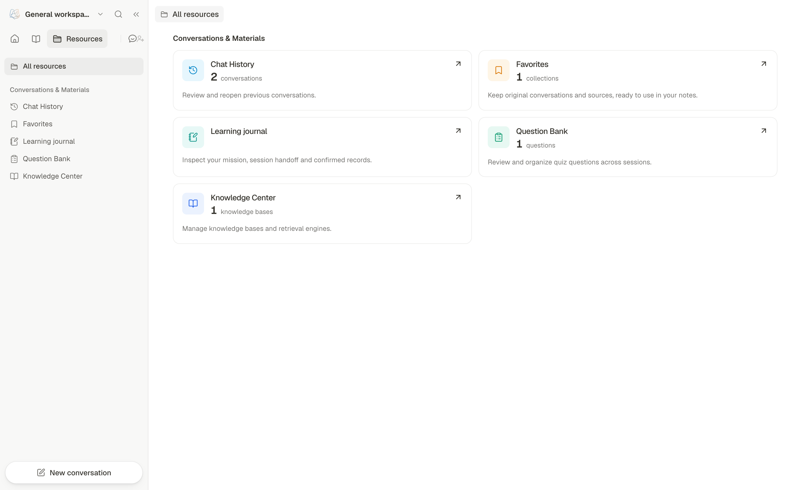
</div>

**Chat History** reopens conversations with their original learning context. **Favorites** preserves useful original conversations and results in movable collections with Markdown export, ready to insert into a Learning notebook. The **Learning journal** records the current mission, session handoff, and confirmed learning records. The **Question Bank** organizes questions, answers, explanations, and mistakes; select a set for **Learning → Practice** to review weak areas and schedule repetition.

</details>

</details>

<details>
<summary><b>🤝 Partners — Persistent Companions Across Workspaces</b></summary>

Partners belong to the account rather than one subject workspace. Each companion keeps its own identity, instructions, model policy, relationships, and channels while using either a private library or an existing workspace's resources.

<div align="center">
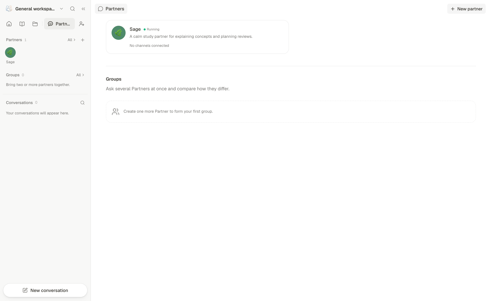
</div>

<details>
<summary><b>Identity, Workspace Resources, Groups, and Channels</b></summary>

Every inbound Web or IM message becomes a normal `ChatOrchestrator` turn — a Partner is "a chat that has a personality and a phone number." Its `SOUL.md`, model selection, tool policy, and library remain editable after creation. A private Partner workspace copies assigned knowledge bases, skills, and Favorites collections; a bound workspace shares its current files and resources instead. Soul, conversations, and relationship memory stay separate in either mode.

<div align="center">

</div>

**Partner Groups** bring two or more Partners into one shared conversation with distinct seats, selectable discussion and shared-memory modes, and durable history. Authenticated users keep private Partner sessions and relationship memory even when a companion is shared.

<div align="center">
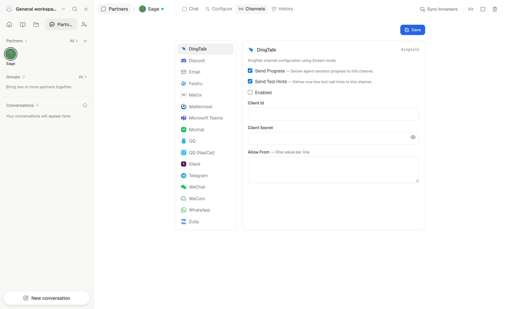
</div>

Schema-driven channels connect companions to Feishu, Telegram, Slack, Discord, DingTalk, QQ/NapCat, WeCom, WhatsApp, Zulip, Mattermost, Matrix, Mochat, and Microsoft Teams, depending on installed extras and credentials. Browser-based setup supports QR onboarding for selected channels. A Partner can also be connected through **Personalization → My Agents** and consulted from a normal Chat turn.

</details>

</details>

<details>
<summary><b>🧭 Personalization — Reusable Behavior and Connections</b></summary>

Personalization follows the account across workspaces. Choose how the tutor should behave and which agents, skills, services, applications, and memories it may reuse; workspace and conversation selections can narrow that access further.

<div align="center">
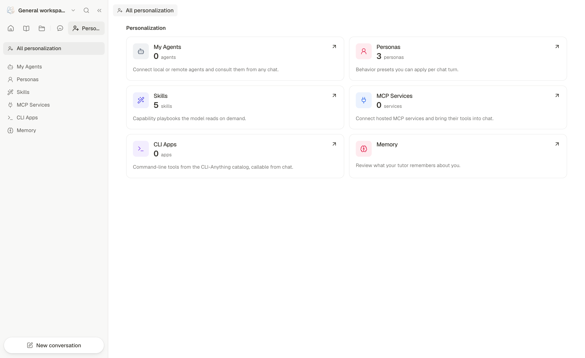
</div>

<details>
<summary><b>🧑‍🚀 My Agents — Consult Live Agents and Import History</b></summary>

<div align="center">
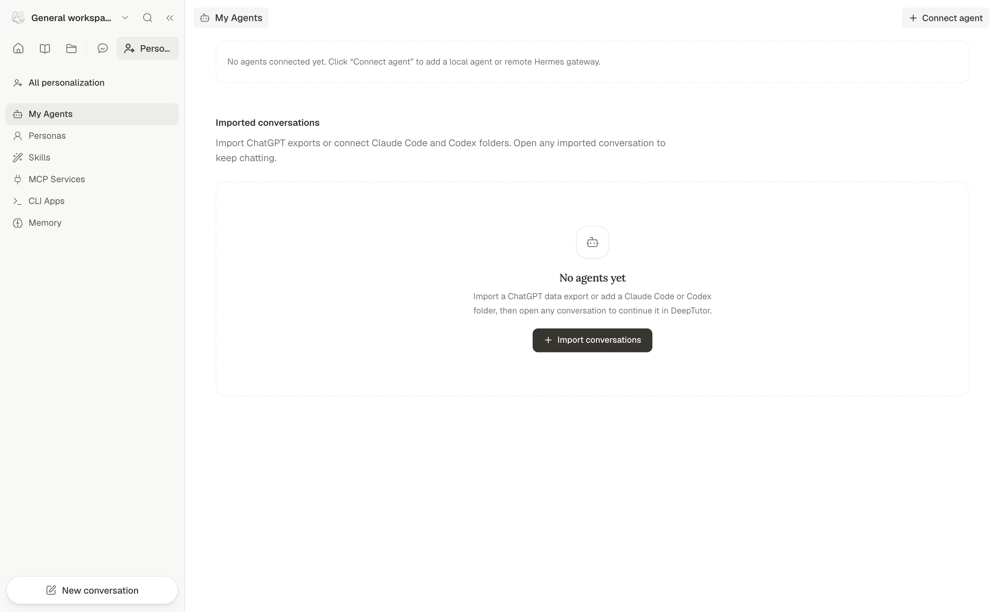
</div>

**Connect a live agent** — Claude Code, Codex, Grok CLI, Antigravity, Kimi, opencode, MiMo Code, Hermes Agent, OpenClaw, DeepSeek Harness, a configured ACP agent, or a Partner — and consult it from a Chat turn. DeepTutor runs the selected agent and streams its work into the Activity panel through `consult_subagent`; the Agent chip or `@` keeps the connection attached to the session. Local harnesses use their own authentication, working directory, and session storage.

**Import past conversations** from ChatGPT, Claude Code, and Codex as searchable, resumable references. ChatGPT uses an official `conversations.json` export; Claude history is selected by project or working directory, and Codex history by date. Reference an imported conversation through `+` → My Agents without turning it into DeepTutor's own voice.

</details>

<details>
<summary><b>🎭 Personas, Skills, MCP Services, and CLI Apps</b></summary>

**Personas** reuse a voice, teaching style, or response policy and can also seed a Partner's soul. **Skills** package repeatable workflows as `SKILL.md` playbooks, with account-shared and workspace-local libraries. **Import from EduHub** browses community skills and installs them through a security gate (see [Ecosystem](#-ecosystem--eduhub--the-skills-community)).

<div align="center">
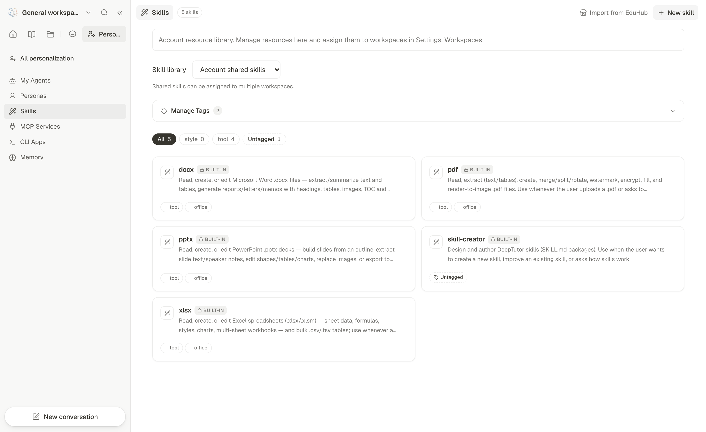
</div>

**MCP Services** authorize external tools, while **CLI Apps** expose installed programs from the [CLI-Anything](https://github.com/HKUDS/CLI-Anything) catalog through the execution sandbox. Workspace assignments and user grants determine which resources each turn may use.

</details>

<details>
<summary><b>🧠 Memory — Inspectable Personalization</b></summary>

<div align="center">
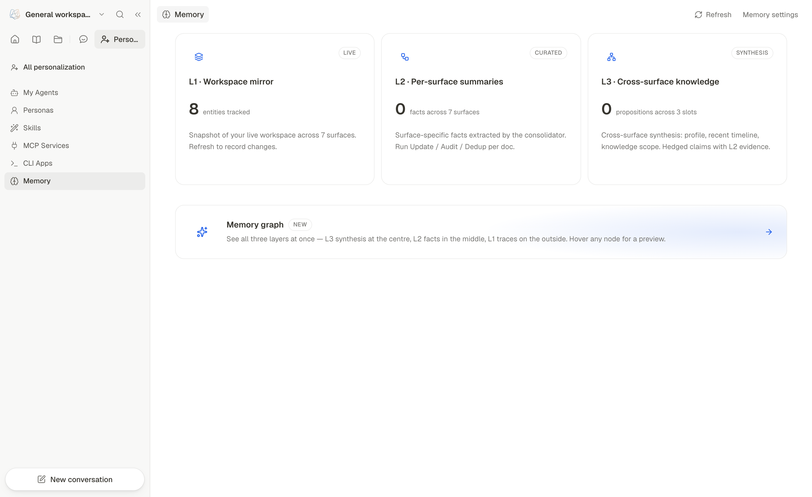
</div>

Memory is a file-backed, three-layer system you can read, curate, and audit — deliberately *not* a hidden vector store. **L1** is the workspace mirror plus an append-only event trace (`trace/<surface>/<date>.jsonl`); **L2** is per-surface curated facts (`L2/<surface>.md`) with references to L1 entities; **L3** is cross-surface synthesis (`L3/<profile|recent|scope|preferences>.md`) that records its contributing L2 surfaces.

<div align="center">
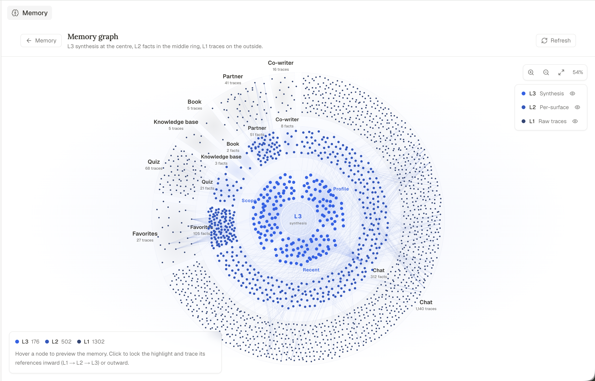
</div>

The Memory Graph shows the whole pyramid — L3 synthesis at the centre, L2 in the middle ring, L1 traces on the outside — with exact L2 → L1 evidence edges and L3 → contributing-surface links. Memory is tracked across `chat`, `notebook`, `quiz`, `kb`, `book`, partner, and `cowriter` surfaces; the consolidator's Update / Audit / Dedup budgets are tuned in **Settings → Memory**.

</details>

<details>
<summary><b>⚙️ Settings — One Control Plane</b></summary>

<div align="center">
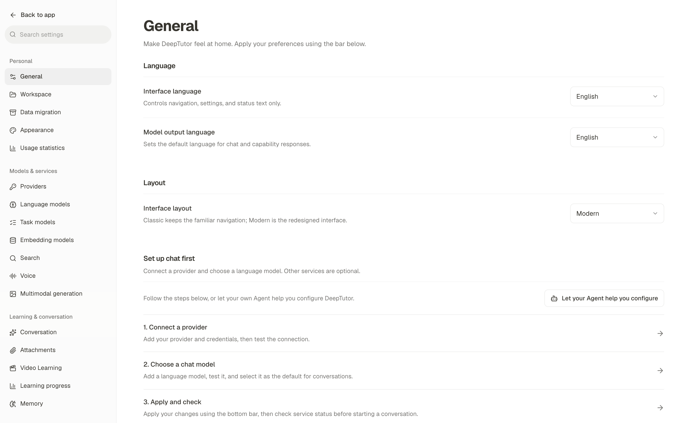
</div>

Settings is the operational control plane, opening on **General** for interface and model output language. Its searchable navigator links to independent pages: **Personal** covers Workspaces, Data migration, Appearance, and Usage statistics; **Learning & conversation** covers starting points, attachments, Video Learning, learner and guardian controls, Learning progress, and Memory; **Models & services** covers Providers, Language models, Task models, Embedding, Search, Voice, and Multimodal generation; **Features & integrations** covers tools, capability parameters, Partners & agents, and Knowledge & documents. **System** holds Network, Runtime status, and About; **Archived chats** lets you search, restore, or permanently delete archived conversations. Runtime status contains backend health, resident memory, and the **Readiness** matrix grading capability blockers, warnings, and suggestions. Workspaces keeps topic files and learning state separate, with verified migration and export under Data migration. A **provider** holds a vendor's address and credential for reuse by its service models; the model pages choose saved providers and configure model names and capabilities. **Task models** pin a small, fast model for automatic work — from naming conversations and writing starting points to Math Animator and Video Lesson repairs — and resolve to the active default when empty. Voice groups speech synthesis and transcription; Multimodal generation groups image and video models. Partners & agents configures local harnesses and a remote Hermes gateway.

**Vietnamese:** In **Settings → General**, choose **Tiếng Việt** for **Interface language** and select **Apply changes**. **Model output language** is independent: choose **Tiếng Việt** there for Vietnamese replies, or keep another reply language while using the Vietnamese interface. Reply quality depends on the selected model's Vietnamese support.

**NVIDIA NIM embeddings:** Select **NVIDIA NIM** under **Settings → Embedding** for text retrieval with `nvidia/nemotron-3.5-embed-8b`. The default endpoint is `https://integrate.api.nvidia.com/v1/embeddings`; a custom full endpoint is used as entered. Indexing sends `input_type=passage`, retrieval sends `input_type=query`, and connection checks default to passage. The hosted model defaults to 4096 dimensions and accepts a configured dimension from 1 to 4096. This binding supports text only; image embeddings and self-hosted model-specific options are outside its scope. Existing OpenAI-compatible profiles retain their previous request behavior; select the NIM binding and re-index when switching an existing knowledge base. See the [NVIDIA API contract](https://docs.api.nvidia.com/nim/reference/nvidia-nemotron-3_5-embed-8b-infer).

**Xiaomi MiMo speech.** Add a Xiaomi MiMo provider with `https://api.xiaomimimo.com/v1` and its API key, then add `mimo-v2.5-tts` under Settings → Voice. Choose a preset such as `mimo_default`, `冰糖`, or `苏打`, use `wav` or `pcm16` output, and audition it before applying. Voice instructions control style and speaking speed. This adapter supports preset speech only; voice design and voice cloning require separate models and are not supported. If an older MiMo speech model was configured through the generic OpenAI-compatible adapter, recreate its speech entry using the Xiaomi MiMo provider so it uses the chat-completions protocol. See the [official MiMo speech guide](https://mimo.mi.com/docs/zh-CN/quick-start/usage-guide/audio/speech-synthesis-v2.5).

**MiniMax speech** — in Settings → Voice, choose MiniMax for text-to-speech and select `speech-2.8-hd`. Configure a MiniMax API key and explicitly select a system voice or enter a custom voice ID. The API base defaults to `https://api.minimax.io/v1`; for the China region use `https://api.minimaxi.com/v1`. Read-aloud and voice previews use the native speech endpoint, with MP3, WAV, FLAC or PCM output, sample rate, speed and language controls. See the [MiniMax speech API](https://platform.minimax.io/docs/api-reference/speech-t2a-http) for voice IDs and account availability.


**Selected-text speech:** select a word or passage in Chat, Mastery Path, or Reading and click **Read aloud** in the nearby toolbar. Click **Stop** to cancel synthesis or playback. This reads only the selection, uses the active TTS provider and voice configured under **Settings → Voice**, and does not send a chat turn. Selection alone never starts playback. A working speech service is required; this feature does not install or select one for you.

**Video Learning** under Settings → Learning & conversation configures YouTube captions and Invidious access for Reading. To use Invidious, set its administrator-managed backend API origin (for example `http://127.0.0.1:3000`) and browser-accessible public origin, test the connection, select Invidious, and save. **Browse Invidious** in Reading's add-material dialog searches videos and accesses connected subscriptions and playlists. YouTube playback uses the official privacy-enhanced player; missing captions remain visible and limit the tutor's evidence without blocking native playback. In a source checkout, run `python scripts/install_extras.py video-learning` for the default YouTube caption loader. Existing Watching links migrate into Reading with conversation history, compatible transcripts, notes, and progress preserved; new timestamp notes are Reading annotations. Bilibili uses its own playback and caption path.

<div align="center">
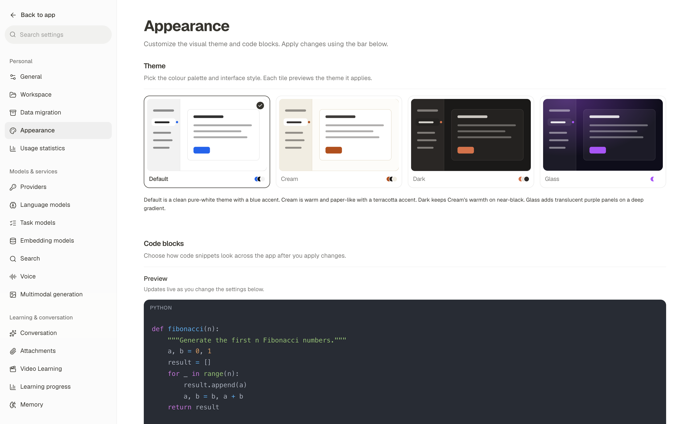
</div>

Most sections use a draft-and-apply flow, so you can test a provider before committing it. You can also just ask in Chat: the assistant reads the current configuration, applies a change, and says whether it needs a restart or a re-index — probing a new model before it commits, so it cannot switch itself onto something unreachable. API keys never pass through the model, which opens the matching form for you instead. Four themes ship in the box — Default, Cream, Dark, and Glass. Project-root `.env` files are intentionally ignored; runtime configuration lives under `data/user/settings/*.json` unless `DEEPTUTOR_HOME` or `deeptutor start --home` points the app elsewhere.

**OpenAI Codex OAuth (experimental).** Adding **OpenAI Codex** under Settings → Providers opens a browser sign-in that runs against your own ChatGPT plan, so no `OPENAI_API_KEY` is needed. Tokens live only in `data/system/user-secrets/<owner>/private/openai-codex/` — in the multi-container Compose deployment, outside every tree the exec sandbox can reach — and DeepTutor never reads or modifies your `~/.codex` CLI login. The model list comes from that account's live catalog; signing in publishes the profile but only becomes the active model when no LLM is configured yet. Because a token authorizes one person's plan, the profile is not shareable through user grants — each account signs in for itself, ordinary users included: their sign-in card sits under Providers, and the resulting models, catalog, and sign-out stay private to that account.

On sign-in and **Refresh models**, DeepTutor reads the latest stable `@openai/codex` version from the official npm registry and uses it as the catalog request's `client_version`. This is metadata-only: it does not install, download, or upgrade the Codex CLI, and the npm request carries no OAuth credentials. Discovery has a three-second deadline and a 64 KiB response limit. If it fails, DeepTutor uses the last successful version for that account, or its built-in fallback when none is cached. Only a successfully parsed live catalog saves a new version; validators are never reused across versions or credential generations. A version rejection or incompatible catalog structure permits one retry with the previous version; authentication, rate-limit, and TLS failures are not retried as version problems. A failed manual refresh reports an error rather than presenting an old cached catalog as refreshed.

Successful version history survives same-account token renewal and catalog authentication errors, without making invalidated model data or ETags usable again. Signing out clears that account's local cache, including the version history. Ordinary status reads and inference do not query npm. New catalog entries do not replace a model you already selected or restart learning sessions; appearing in the catalog does not establish full inference-protocol compatibility. There is no background version updater or user version setting.

Default local Docker and Podman deployments use separate loopback networks and need a temporary bridge during sign-in. Follow the [temporary local Codex OAuth bridge guide](./docs-for-dev/CONTAINERIZATION.md#temporary-local-codex-oauth-bridge) for the exact Docker, Compose, Podman, and teardown commands.

For a remote deployment, the browser's `localhost` and the server's `localhost` are different machines, so an ordinary reverse proxy alone cannot carry the browser's localhost callback to the server. Use an SSH tunnel as the callback bridge. The tunnel reaches the already-published Web port; Next.js rewrites only the exact callback path to the public callback broker, and the broker validates `state` before routing to the original OAuth operation. The callback listener remains on the backend loopback, ports `1455` and `1457` are not published, and this path supports the default Docker bridge network.

```bash
ssh -N -L 1455:127.0.0.1:3782 <ssh-user>@<server-host>
```

If DeepTutor reports fallback callback port `1457`, use:

```bash
ssh -N -L 1457:127.0.0.1:3782 <ssh-user>@<server-host>
```

Run only the one command that matches the actual callback port; never run both. `3782` is only the example Web port: it is the configured frontend/container port reported as `callback_forward_port`. That value does not guarantee that the same port is listening on the SSH host's `127.0.0.1`. If Docker or Podman publishes a different host port, or a reverse proxy listens on a different port, replace only the right-hand target port (`3782` above) with the Web port actually listening on the SSH host's `127.0.0.1`; keep the left-hand callback port as `1455` or `1457`. `<server-host>` is the SSH host whose loopback owns that listening port. If the browser URL names a reverse proxy or load balancer, replace it with the correct SSH frontend host.

The CLI prints the tunnel command and then immediately tries to open the browser. On a remote deployment, keep the authorization page open without completing it, establish the printed tunnel in another terminal, and only then continue authorization.

Remote-topology detection has a localhost boundary. If Web itself is reached through an SSH or IDE localhost forward, the browser cannot tell that the server is remote. For the current Web operation, leave its authorization page unfinished, read `redirect_uri` in that operation's authorize URL to identify callback port `1455` or `1457`, and create the second tunnel from that local port to the actual Web port. Alternatively, cancel that Web operation and start a new one with the CLI; the CLI output belongs to the new operation and must not be used for the existing Web operation. Quota errors and catalog failures are reported as-is and never fall back to a paid provider. This compatibility path is experimental: the upstream interface may change.

</details>

</details>

### 🛠️ Administration & Shared Deployments

The five areas above describe the learner-facing workspace. The following deployment controls are for administrators hosting DeepTutor for multiple users.

<details>
<summary><b>👥 Multi-User — Shared Deployments</b> · optional auth, isolated per-user workspaces</summary>

Authentication is **off by default** — DeepTutor runs single-user. Turn it on and one `data/` tree hosts an admin workspace, isolated per-user workspaces, and partner workspaces side by side:

```text
data/
├── user/                    # Admin workspace + global settings
├── users/<uid>/             # Per-user scope: chat history, memory, notebooks, KBs
├── partners/<id>/workspace/ # Partner (synthetic-user) scope
├── cli-apps/                # Installed CLI apps, mounted read-only into the sandbox
└── system/                  # auth · grants · audit · user-secrets/<owner> (OAuth tokens)
```

The **first registered user becomes admin** and owns model catalogs, provider credentials, shared knowledge bases, skills, canonical shared books, and per-user grants. Admin-created local users choose Standard, Learner, or Custom. Learner locks learning capabilities and material policy, adds an adaptive profile, and supports revocable device credentials with expiry and daily limits; authorized guardians can view reports, approve materials, and reset credentials. Other users get isolated workspaces plus scoped models, KBs, skills, partners, and shared-book access without receiving raw API keys. If `auth.json` already carries a `username` + `password_hash`, that account *is* the admin: `/register` stays closed and accounts created from `/admin/users` are always `role=user` until you promote them.

**Enable it:** turn auth on in `data/user/settings/auth.json`, restart `deeptutor start`, register the first admin at `/register`, then add users from `/admin/users` and assign models, KBs, skills, partners, tool/MCP/CLI-app policy, and code-execution access through grants; configure shared books under each user's **Book access** panel.

For split private/public origins, set `auth.private_login_hosts` (or `AUTH_PRIVATE_LOGIN_HOSTS`) to the private frontend hosts that may show password sign-in and registration. The frontend forwards the incoming HTTP `Host` to the backend as its frontend-host assertion. Preserve the browser's `Host` through your reverse proxy, and make the public ingress reject requests naming a private host; do not expose a raw Next.js port that accepts arbitrary `Host` values. HTTP `Host` can be forged by a direct client, so private-host authorization depends on that ingress boundary. The backend accepts frontend-host assertions only from loopback by default. If the Web frontend connects from another container or host, set `AUTH_TRUSTED_FRONTEND_PROXY_IPS` to that frontend proxy's exact IP address on the backend process (comma-separated for more than one). This replaces the defaults; include `127.0.0.1,::1` if local frontend connections are also needed. Keep the backend API private to the frontend proxy and do not include general client networks in this list. When `private_login_hosts` is non-empty, an authenticated user on a private origin can open **Profile → Public device sign-in** and create a short-lived, host-bound pairing link for an HTTPS public origin. The public `/handoff` page exchanges the one-time code for an equally short JWE ticket in a POST body, consumes the ticket once, and receives the normal HttpOnly session cookie.

> PocketBase stays a single-user integration — keep `integrations.pocketbase_url` blank for multi-user deployments unless you've wired up an external user store.

</details>

## ⌨️ DeepTutor CLI — Agent-Native Interface

One `deeptutor` binary, two ways in: an interactive **REPL** for people who live in the terminal, and structured **JSON** for other agents that drive DeepTutor as a tool. Same capabilities, tools, and knowledge bases either way.

<details>
<summary><b>Drive it yourself</b></summary>

`deeptutor chat` opens an interactive REPL and selects a mode with `--capability`; `deeptutor run <capability> "<message>"` takes that capability as its first positional argument and exits after one turn. Both accept `--tool`, `--kb`, `--config`, and `--workspace` to select a registered workspace.

```bash
deeptutor chat                                              # interactive REPL
deeptutor chat --capability deep_solve --kb my-kb
deeptutor run chat "Explain the Fourier transform" --kb textbook
deeptutor run chat "Find recent work beyond this material" --kb textbook
deeptutor run deep_research "Survey 2026 papers on RAG" \
  --config mode=report --config depth=standard
```

`--kb` supplies context for automatic RAG and Knowledge Frontier tools; Frontier needs both knowledge and research modules. `--tool` selects user-toggleable tools. Enabled modules also provide KB, session, partner, skill, notebook, memory, and config commands.

</details>

<details>
<summary><b>Let an agent drive it</b></summary>

DeepTutor is built to be *operated by another agent*. Add `--format json` to any `run` and each turn streams **NDJSON — one event per line** (`content`, `tool_call`, `tool_result`, `done`, …), every line tagged with its `session_id`. Runs are headless-safe: an `ask_user` pause with no TTY auto-resolves with an empty reply instead of hanging.

```bash
# One shot, machine-readable
deeptutor run deep_solve "Find d/dx[sin(x^2)]" --tool reason --format json

# Chain turns in one stateful session — capture the id, reuse it
SID=$(deeptutor run deep_research "Survey 2026 papers on RAG" \
  --config mode=report --config depth=standard --format json \
  | jq -r 'select(.type=="done").session_id')
deeptutor run deep_question "Quiz me on that survey" --session "$SID" --format json
```

The repo ships a root [`SKILL.md`](SKILL.md) — a compact handover doc for the CLI. Ask your agent to read it explicitly; its [Agent Setup guide](docs-for-dev/AGENT_SETUP.md) covers installation and configuration. You can also wrap `deeptutor run` as a tool in a LangChain / AutoGen loop. Full recipes: [Agent Handoff](https://deeptutor.info/docs/cli/agent-handoff/).

</details>

<details>
<summary><b>Opt-in visual review for Manim animations</b></summary>

Set `enable_visual_review=true` to inspect rendered frames for overlap, readability,
and framing, then feed detected issues into the existing code repair loop:

```bash
deeptutor run math_animator "Animate a sine wave" --config enable_visual_review=true
deeptutor run visualize "Animate a sine wave" \
  --config render_mode=manim_video --config enable_visual_review=true
```

The option defaults to `false`. It also works with `output_mode=image` for
`math_animator` and `render_mode=manim_image` for `visualize`. Other visualizers,
including the general `auto` loop, ignore it. Manim's optional dependencies are
still required.

For SDK turns, pass `config={"enable_visual_review": True}` in the `TurnRequest`
sent to `DeepTutorApp.start_turn()`. API clients use the same `config` object with
JSON `true`. For book animation blocks, set
`params={"enable_visual_review": True}` on the animation `Block`.

Review adds vision model calls and may add repair calls and re-renders, increasing
cost and latency. It uses the existing limit of four retries, with a 120-second
review timeout and a 180-second repair timeout. If no frames are available or the
configured review model cannot inspect images, review is skipped with a summary.
An unsuccessful review after all retries returns the best available render and its
failed review result; a review timeout follows the existing render error/retry path.
Capability results expose `render.visual_review`; book blocks retain the same
review data in `metadata.visual_review` (`null` when review did not run).

</details>

<details>
<summary><b>Command reference</b></summary>

The table covers the full installation and optional add-ons; commands and capabilities require their modules to be enabled. Core provides `chat` and `ask_questions`.

| Command | Description |
|:---|:---|
| `deeptutor init [--non-interactive] [--home PATH]` | Run the setup wizard, or create missing defaults without prompts |
| `deeptutor doctor [--online]` | Check whether the runtime is ready to start a session; `--online` also probes the configured model provider, `--format json` prints the report |
| `deeptutor start [--home PATH] [--dev] [--detach] [--no-browser]` | Launch backend + frontend together; optionally detach or suppress browser opening |
| `deeptutor stop [--home PATH]` | Stop a launcher started with `--detach` |
| `deeptutor serve [--port PORT]` | Start only the FastAPI backend |
| `deeptutor module list/install/uninstall/enable/disable` | Inspect modules and change them with DeepTutor stopped; source checkouts support enable/disable |
| `deeptutor workspace show/set/reset` | Inspect, select, or restore the per-user Content Workspace |
| `deeptutor run <capability> <message>` | Run a single capability turn (`chat`, `ask_questions`, `deep_solve`, `deep_question`, `deep_research`, `visualize`, `math_animator`, `video_lesson`, `mastery_path`, `immersive_reading`, `audio_overview`); add `--format json` for NDJSON output |
| `deeptutor chat` | Interactive REPL with capability, tool, KB, notebook, and history controls |
| `deeptutor partner list/create/start/stop` | Manage IM-connected partners |
| `deeptutor kb list/info/create/connect-kiwix/add/search/eval/eval-diff/set-default/delete/list-sources/sync` | Manage knowledge bases, connect Kiwix archives, score and compare retrieval runs, and synchronize registered GitHub/web sources (with source add/remove commands) |
| `deeptutor skill search/install/list/remove/login/logout/publish/update` | Manage skills, install from hubs, and publish your own (`eduhub:<slug>` by default, see Ecosystem) |
| `deeptutor memory show/clear` | Inspect L2/L3 memory docs or clear L1/all memory |
| `deeptutor session list/show/open/rename/delete` | Manage shared sessions |
| `deeptutor notebook list/create/show/add-md/replace-md/remove-record` | Manage notebooks from Markdown files |
| `deeptutor book list/health/refresh-fingerprints` | Inspect books and refresh source fingerprints |
| `deeptutor plugin list/info/state/search/show/install/approve/enable/disable/rollback/uninstall` | Inspect tools and capabilities; manage reviewed plugin packages and their permission approvals |
| `deeptutor config show [--home PATH]` | Show resolved runtime configuration with credentials redacted |
| `deeptutor config providers` | List supported setup providers and defaults as JSON |
| `deeptutor config apply FILE [--check] [--home PATH]` | Apply setup JSON without prompts, or validate it without writing settings |
| `deeptutor provider login <provider>` | Provider auth (`openai-codex` OAuth login; `github-copilot` GitHub device login; `codebuddy` validates CodeBuddy SDK auth and starts login when needed) |

GitHub Copilot credentials belong to the signed-in DeepTutor owner and live only at
`<runtime-home>/data/system/user-secrets/<owner-id>/private/github-copilot/credentials.v1.json`,
outside sandbox workspaces. CLI/admin partners use the administrator's credentials;
other users sign in separately, and Copilot profiles cannot be shared through model grants.
External nanobot/Copilot token files are never imported: after upgrading, run
`deeptutor provider login github-copilot` again.

Login validates inference with a currently discovered model; `init` validates the selected
model and aborts on failure without saving the draft configuration. Successful GitHub
authentication alone does not establish Copilot model access (the saved login is retained
if validation fails). Runtime requests follow the API endpoint returned by token exchange,
including refreshes, and respect each model's Responses/Chat Completions endpoint metadata.

Copilot-specific Responses compatibility is applied at dispatch without rewriting stored history.

</details>

<details>
<summary><b>CLI-only distribution</b></summary>

The core wheel supplies CLI and SDK; `deeptutor-cli` is a compatibility metapackage. Source exposes all checked-in modules, so install their Python dependencies and skip frontend setup for CLI use:

```bash
python -m pip install -r requirements/full.txt
python -m pip install -e . --no-deps
```

For a minimal installation, use the core wheel. Optional distributions contribute tools, capabilities, API routes, background services, and navigation. Modules share one Python environment and must match the core version. `deeptutor[full]` selects the common app modules at installation; individual features can still be removed later.

Stop DeepTutor (`Ctrl+C` in its terminal), then use the same Python environment and `DEEPTUTOR_HOME`:

```bash
deeptutor module list                       # installed / enabled / ready
deeptutor module disable research           # hide and deactivate; keep code
deeptutor module enable research            # restore it and required modules

# Package installations only; source checkouts use enable / disable:
deeptutor module install solve              # install the matching module and dependencies
deeptutor module uninstall solve --dry-run  # inspect the plan and dependency blockers
deeptutor module uninstall solve            # remove only this module's distribution
deeptutor chat                              # restart the CLI; use start for an installed Web app
```

Examples: `solve`, `research`, `questions`, `knowledge`, `parsing`, `reading`, `mastery`, `books`, `memory`, `notebook`, and `partners`. Dependents block removal; core cannot be removed through the module command. Disabling or uninstalling preserves settings, conversations, knowledge bases, and generated files. Shared third-party dependencies are retained.

**In the browser:** **Settings → Runtime status → Modules** shows module status and the corresponding terminal commands. Package changes require a stopped environment and are performed in the CLI. **Chat → Customize page** and **Learning → New learning activity → Customize page** change personal page choices immediately; hiding an entry does not uninstall its module or revoke access.

The 1.7.0 package family uses matching versions across core and feature wheels. For local wheel installation, pass `--wheelhouse /path/to/wheels` to `module install`. See [module installation and source development](docs-for-dev/MODULES.md) for building the wheels and deployment details.

</details>

## 🧩 Ecosystem — EduHub & the Skills Community

DeepTutor skills use the open **Agent-Skills** format — a folder with a `SKILL.md` playbook (YAML frontmatter + Markdown) and optional reference files. Nothing about it is DeepTutor-specific, so any registry that speaks the format becomes a source for your library. DeepTutor ships with **[EduHub](https://eduhub.deeptutor.info/)** — our own education-focused skill registry — wired in as the default hub.

<details>
<summary><b>EduHub — DeepTutor's skill ecosystem</b></summary>

[**EduHub**](https://eduhub.deeptutor.info/) is the community hub DeepTutor launched for sharing teaching-oriented agent skills — Socratic tutors, flashcard builders, essay feedback, exam blueprints, concept explainers, and more. It is built into DeepTutor, so there's nothing to configure: a bare slug or an `eduhub:` prefix resolves to it.

**Find and install** — in the browser, open **Personalization → Skills → Import from EduHub** to browse the catalog and download a skill straight into your library. From the terminal:

```bash
deeptutor skill search "socratic tutor"               # search EduHub (the default hub)
deeptutor skill install socratic-tutor                # fetch → verify → register
deeptutor skill install eduhub:socratic-tutor@1.2.0   # pin a hub and a version
deeptutor skill list                                  # local skills with their hub provenance
```

**Publish your own** — package a `SKILL.md` and share it back to the community:

```bash
deeptutor skill login                                 # browser sign-in to EduHub
deeptutor skill publish ./my-skill                    # interactive: pick a track + tags, then upload
deeptutor skill update                                # roll back or release a new version
```

EduHub is also a standalone, ClawHub-compatible registry, so agents that aren't DeepTutor (Claude Code, Codex, …) can use it directly through the `eduhub` CLI — `npx eduhub install socratic-tutor`.

</details>

<details>
<summary><b>The import safety gate</b></summary>

Whatever the source, every import passes the **same safety gate** before anything touches your workspace:

- the registry's **security verdict** is checked first — flagged packages are refused unless you pass `--allow-unverified`;
- archives are extracted defensively with path-traversal, entry-count, size, compression-ratio, suffix, and symlink checks; executable bits are stripped, while extensionless files remain allowed;
- frontmatter is normalized to DeepTutor's schema and `always:` is **stripped**, so a downloaded skill can never force itself into every system prompt;
- provenance — hub, version, verdict, and install time — is written to `.hub-lock.json` for audits and updates.

In multi-user deployments, browser imports land in the authenticated caller's skill layer, while CLI and admin-console installs target the owner/admin workspace; admin skills stay hidden and read-only for ordinary users until granted.

</details>

<details>
<summary><b>Also compatible with ClawHub</b></summary>

Because DeepTutor speaks the open Agent-Skills format, **[ClawHub](https://clawhub.ai/)** works as a first-class source too — it's built in alongside EduHub. Pick it with the hub prefix:

```bash
deeptutor skill search "git release notes" --hub clawhub
deeptutor skill install clawhub:git-release-notes@1.0.1
deeptutor skill install clawhub:udiedrichsen/stock-analysis
```

When several publishers share the same slug, search shows each publisher and a
fully scoped install ref (`clawhub:<ownerHandle>/<slug>`).

Add more registries in `data/user/settings/skill_hubs.json`: a `type: "clawhub"` entry points at any compatible HTTP API (EduHub and ClawHub both speak it), `type: "command"` wraps whatever fetch CLI a registry ships, and `"default"` chooses the hub used for bare slugs. All of them feed the same import gate.

</details>

## 🤝 Open Source Partners

<p align="center">
  <a href="https://github.com/VectifyAI/PageIndex" target="_blank">
    <picture>
      <source media="(prefers-color-scheme: dark)" srcset="assets/figs/partners/pageindex-mark-dark.svg">
      <source media="(prefers-color-scheme: light)" srcset="assets/figs/partners/pageindex-mark.svg">
      
    </picture>
  </a>
</p>

<p align="center">
  Using code: <b><code>DEEPTUTOR20</code></b> — get $20 off for your first <a href="https://developer.pageindex.ai/">PageIndex subscription</a>!
</p>

## 🌐 Community

### 🔗 Maintainers

<table>
  <tr>
    <td align="center"><a href="https://github.com/pancacake"><br><strong>Bingxi Zhao</strong></a></td>
    <td align="center"><a href="https://github.com/TyrionH-is-coding"><br><strong>Xingyu Hou</strong></a></td>
    <td align="center"><a href="https://github.com/zzhtx258"><br><strong>Jiahao Zhang</strong></a></td>
  </tr>
</table>

### 📮 Contact

DeepTutor is an open-source project led by [Bingxi Zhao](https://github.com/pancacake) within the [HKUDS](https://github.com/HKUDS) Group, and it iterates in a **fully open-source form**, built together with the community. So far, we **DO NOT** have paid online products of any form. Feel free to reach out at **bingxizhao39@gmail.com** for discussions, ideas, or collaboration.

### 🙏 Appreciation

Heartfelt thanks to [**Chao Huang**](https://sites.google.com/view/chaoh), director of the Data Intelligence Lab @ HKU, and to our HKUDS labmates for their warm support — especially [**Jiahao Zhang**](https://github.com/zzhtx258), [**Zirui Guo**](https://github.com/LarFii), and [**Xubin Ren**](https://github.com/Re-bin). We're also deeply grateful to the **open-source community**: your stars, issues, pull requests, and discussions shape DeepTutor every single day.

DeepTutor also stands on the shoulders of outstanding open-source projects that gave us both tools and inspiration:

| Project | Role / Inspiration |
|:---|:---|
| [**LlamaIndex**](https://github.com/run-llama/llama_index) | RAG pipeline and document-indexing backbone |
| [**nanobot**](https://github.com/HKUDS/nanobot) | Ultra-lightweight agent engine that powered the original TutorBot *(HKUDS)* |
| [**LightRAG**](https://github.com/HKUDS/LightRAG) | Simple & fast RAG *(HKUDS)* |
| [**AutoAgent**](https://github.com/HKUDS/AutoAgent) | Zero-code agent framework *(HKUDS)* |
| [**AI-Researcher**](https://github.com/HKUDS/AI-Researcher) | Automated research pipeline *(HKUDS)* |
| [**OpenClaw**](https://github.com/openclaw/openclaw) | Open agent gateway and skill ecosystem behind ClawHub |
| [**Codex**](https://github.com/openai/codex) | Agent-native coding CLI that inspired our CLI workflow |
| [**Claude Code**](https://github.com/anthropics/claude-code) | Agentic coding CLI that inspired the DeepTutor agent loop |
| [**ManimCat**](https://github.com/Wing900/ManimCat) | AI-driven math animation generation for Math Animator |

### 🗺️ Roadmap & Contribute

We want DeepTutor to keep iterating and improving — and ultimately to become a gift we give back to the open-source community. Our [**roadmap**](https://github.com/HKUDS/DeepTutor/issues/498) is updated continuously; vote on items there or propose new ones. If you'd like to contribute, see the [**Contributing Guide**](CONTRIBUTING.md) for branching strategy, coding standards, and how to get started.

<div align="center">

We hope DeepTutor becomes a gift for the community. 🎁

See the [development-branch contributor list](CONTRIBUTORS.md) for recently integrated contributions.

<a href="https://github.com/HKUDS/DeepTutor/graphs/contributors">
  
</a>

</div>

<p align="center">
 <a href="https://www.star-history.com/hkuds/deeptutor">
  <picture>
   <source media="(prefers-color-scheme: dark)" srcset="https://api.star-history.com/badge?repo=HKUDS/DeepTutor&theme=dark" />
   <source media="(prefers-color-scheme: light)" srcset="https://api.star-history.com/badge?repo=HKUDS/DeepTutor" />
   
  </picture>
 </a>
</p>

<div align="center">

Licensed under the [Apache License 2.0](LICENSE).

<p>
  
</p>

</div>
